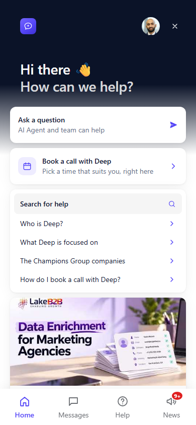
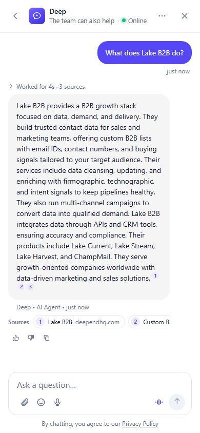
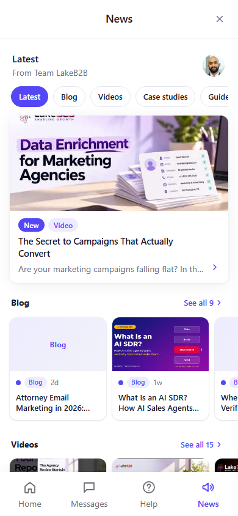
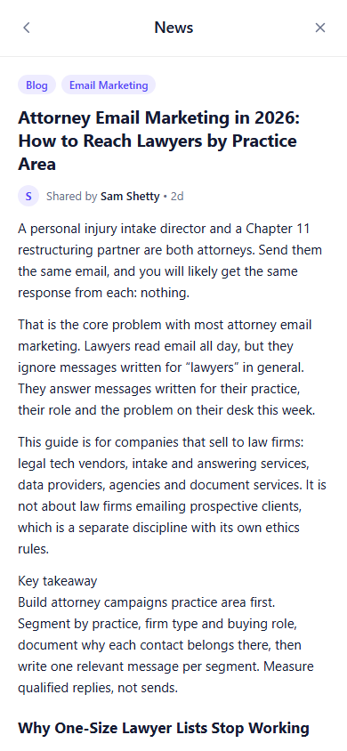
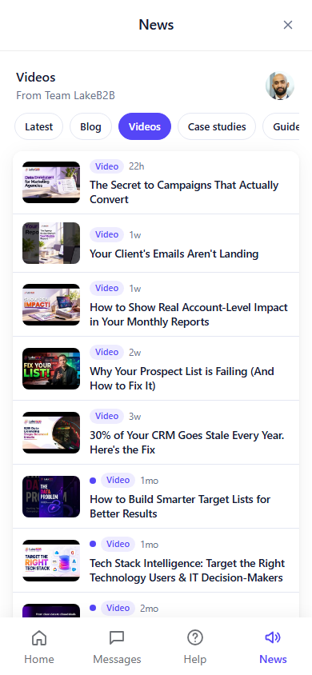
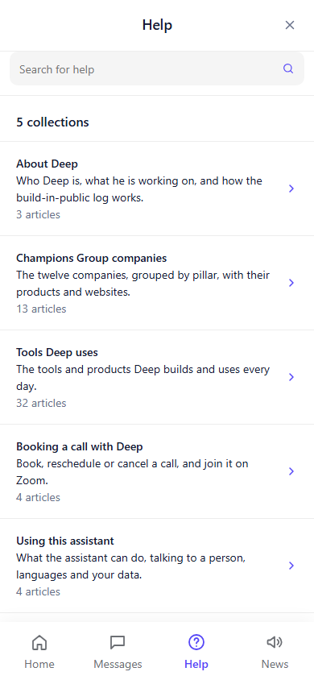
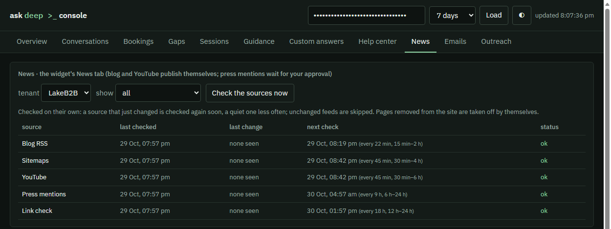
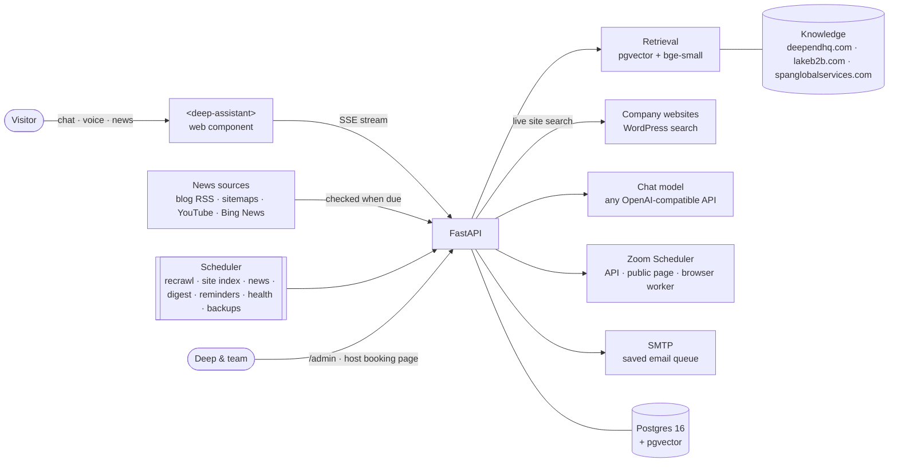

<div align="center">

# ask deep `>_`

### The AI messenger for deependhq.com and the Champions Group companies

It answers questions with sources from **deependhq.com**, **lakeb2b.com** and **spanglobalservices.com**, books calls
on Deep's Zoom calendar right inside the chat, keeps a live **News** feed, and gives Deep a brief on every lead before
the call.


[Highlights](#-highlights) · [Screenshots](#-a-closer-look) · [How it works](#-how-it-works) ·
[Quick start](#-quick-start) · [Embed it](#-embed-it) · [Tests](#-tests) · [Project layout](#-project-layout) ·
[Docs](#-documentation)

<br>

<table>
  <tr>
    <td align="center"><br><sub><b>Home</b></sub></td>
    <td align="center"><br><sub><b>Answers with sources</b></sub></td>
    <td align="center"><br><sub><b>News at a glance</b></sub></td>
    <td align="center"><br><sub><b>Read inside the chat</b></sub></td>
  </tr>
</table>

</div>

---

## ✨ Highlights

### For visitors

| | |
|---|---|
| 💬 **Answers with sources** | Every answer cites the pages it came from: deependhq.com first, then the companies' own websites. Off-topic questions get a polite "I'd rather not guess", never an invented answer. |
| 🌐 **Knows the company websites** | LakeB2B and SPAN Global Services are read page by page and kept fresh every few hours. A question the index can't answer yet is searched live on that company's own site. |
| 📅 **Book a call in the chat** | Call type → date → time → confirm, with guests, a Zoom link and a calendar invite. Reschedule or cancel from the chat or from any email. |
| 📰 **News, like Intercom's** | Blog posts, videos, case studies, newsletters and announcements from each company. A featured story, a sideways row per feed, articles that open inside the chat, labels, "Shared by" and 💜😴👎🎉 reactions. |
| 🧭 **Help center** | Collections and articles in the Help tab, searchable by meaning, editable by Deep. |
| 🎙️ **Voice in any language** | A mic button and a hands-free voice call; answers come back in the visitor's language. |
| 🧠 **Remembers you** | "Welcome back", your last topic, upcoming calls and earlier conversations, on any device you open it from. |

### For Deep and the team

| | |
|---|---|
| 📋 **Pre-call brief & honest lead score** | Who they are, what they asked, what they read, where they came from, and a 0–100 score where every point is backed by evidence the visitor can't just type. |
| 🖥️ **Owner console** (`/admin`) | Conversations, bookings, knowledge gaps, help center, news moderation, email templates, outreach rules and source health in one place. |
| 👥 **Team replies in the chat** | Reply from the console; the answer appears in the visitor's chat, and they get an email if they've left. |
| 📈 **Learns every day** | Unanswered questions become drafted answers to approve; call outcomes re-weight the lead score. |
| 🔔 **Tells you when something breaks** | Health checks on the model key, credit, database, email, backups and news sources, with an alert email. |

### Under the hood

| | |
|---|---|
| ⚡ **News that checks itself** | Each source is checked again soon after it changes and less often while quiet; unchanged feeds cost one 304. Edited pages show "Updated", removed pages leave by themselves. |
| 🔎 **One search over every site** | deependhq.com's own pages are always scored in full, so the larger company sites can never crowd them out; a company that is named gets its own pages first. |
| 🛡️ **Safe by default** | CORS allow-list, rate limits, a daily spend cap, signed email links, prompt-injection fences, sanitised news HTML, retention purges. |
| 💾 **Hard to lose** | Nightly database backups, a saved email queue that resends after a crash, a backup chat model, and one scheduler runner across instances. |

> The full list, with every rule and setting behind each feature, is in **[docs/FEATURES.md](docs/FEATURES.md)**.

## 🖼 A closer look

<table>
  <tr>
    <td align="center" width="50%"><br><sub>A feed as a compact list: picture, label, age, title</sub></td>
    <td align="center" width="50%"><br><sub>The help center, written from deependhq.com</sub></td>
  </tr>
</table>

<p align="center"><br>
<sub>Console → News: every source with its last check, last change, next check and status</sub></p>

## 🏗 How it works



Embeddings run locally (`BAAI/bge-small-en-v1.5` via fastembed: no key, no cost). The chat model is any
OpenAI-compatible endpoint (OpenRouter, Groq or OpenAI), with a backup model if the first one fails.

| Step | What happens |
|---|---|
| **1. Understand** | Small talk is answered warmly; a follow-up ("tell me more") is rewritten into a full question. |
| **2. Search** | deependhq.com, the company websites and the help center are searched together; dates ("last week"), day numbers and company names are handled specially. |
| **3. Look further** | A company question the index can't answer goes to that company's own site search, live. |
| **4. Answer** | The model answers only from those sources and cites them, or says it couldn't find it and offers a call. |
| **5. Act** | Booking, rescheduling and handing over to the team happen as tools inside the same chat. |

## 🚀 Quick start

**Needs:** Python 3.11+. Nothing else: no Docker, no Postgres install. An API key for a chat model
(e.g. a free Groq key) turns on generated answers; without one the assistant runs in quoted-text mode.

```bash
python -m venv .venv && .venv/Scripts/pip install -r requirements.txt   # macOS/Linux: .venv/bin/pip
.venv/Scripts/python -m app.launch                                       # Windows: double-click run.cmd instead
```

`app.launch` creates `.env` from `.env.example` if missing, starts an **embedded Postgres + pgvector**
(`pgserver`, data in `./data/pg`), creates the schema, crawls and embeds deependhq.com on the first run only
(~1 min; the local embedding model downloads once, ~130 MB), starts the server and opens the embed preview.
Run it again and the site data and chat history are still there. A busy port, a missing widget file or an
unreachable `DATABASE_URL` stop it with the fix spelled out.

Already have Postgres? Set `DATABASE_URL` in `.env` and the launcher uses it instead; the embedded database is
only for the case where nothing is configured. The embedded database is a real Postgres 16 process, one per
install: fine for a single server, not for several app instances sharing data (point them at one `DATABASE_URL`).

Then open:

| URL | What |
|---|---|
| http://127.0.0.1:8080 | the assistant, full screen |
| http://127.0.0.1:8080/site | the way deependhq.com shows it (launcher, greeting, quick replies) |
| http://127.0.0.1:8080/admin | owner console (needs `ADMIN_TOKEN`) |
| http://127.0.0.1:8080/demo | host-app demo with a signed-in user (`WIDGET_DEMO=true`) |
| http://127.0.0.1:8080/host/booking/sample | the host booking page filled with a sample booking |

<details>
<summary><b>Windows: one double-click</b></summary>

`run.cmd` creates `.venv` and installs the runtime requirements if they are missing, then runs `python -m app.launch`
(embedded database unless `DATABASE_URL` points at a reachable server). It uses the interpreter in `RUN_PYTHON`
from `.env`, else `.venv` in the project, passes `FASTEMBED_CACHE_PATH` from `.env` to the embedding model and sets
`OPENBLAS_NUM_THREADS=1` itself. `run.cmd -Docker` keeps the previous path: Docker Desktop → `docker compose up db`
→ uvicorn.

Tips: use `127.0.0.1` rather than `localhost` in `DATABASE_URL` (Docker Desktop's IPv6 relay stalls). On Windows
keep the project in a short path (`C:\deep-agent`): the local embedding stack installs files whose names exceed
Windows' 260-character limit under a long folder name, or enable long paths in Windows.
</details>

<details>
<summary><b>Docker / an existing Postgres</b></summary>

```bash
docker compose up --build -d          # Postgres 16 + pgvector, the app and the ingest job
docker compose run --rm ingest
```

or, with your own Postgres, set `DATABASE_URL` in `.env` and run `python -m app.ingest.pipeline` then
`uvicorn app.main:app --port 8080`. The MaxMind GeoLite2 files live in the `geoip` volume, so they survive rebuilds.
</details>

<details>
<summary><b>Models stay behind APIs</b></summary>

Chat always goes to the OpenAI-compatible endpoint in `LLM_BASE_URL` with `LLM_API_KEY`; the key lives on the
server and never reaches the widget. Without a key the assistant answers in **quoted-text mode**: the matching
page text with its sources, labelled as such, and no generated sentences. A provider timeout or rejected key
gives a labelled "having trouble answering" reply with the booking link and email, never a dead stream.

Embeddings are local by default (fastembed, no key). Set `EMBED_PROVIDER=api` with an `/embeddings`-capable
`EMBED_BASE_URL` and `EMBED_API_KEY` (defaults: the LLM ones) to keep them remote too; set `EMBED_DIM` for a model
the app doesn't know, and re-run the ingest after switching. OpenRouter has no embeddings endpoint.

Booking: with Zoom API credentials the meeting is created for real; otherwise the visitor gets a prefilled
Zoom hand-off link and the chat says so (`pending_zoom`). The widget never reports a meeting as booked unless a
provider confirmed it.
</details>

Every setting, the go-live checklist and deploying to a server: **[docs/CONFIGURATION.md](docs/CONFIGURATION.md)**.

## 🔌 Embed it

**On deependhq.com** (launcher bubble, greeting card):

```html
<script src="https://<assistant-host>/static/widget.js" defer></script>
```

**In any app** (React, Vue, Angular, plain HTML):

```html
<script type="module" src="https://<assistant-host>/static/deep-assistant.js"></script>
<deep-assistant api="https://<assistant-host>" mode="launcher" theme="auto"></deep-assistant>
```

Ready-made wrappers: [`widget/react/DeepAssistant.tsx`](widget/react/DeepAssistant.tsx) and
[`widget/vue/DeepAssistant.vue`](widget/vue/DeepAssistant.vue). The component fires `deep-assistant:*` events
(`ready`, `question`, `answer`, `booking`, `handover`, `ui`, …) for the host page's analytics. Swapping out the
current Widgo chat on deependhq.com is covered step by step in [WIDGET_SWAP](docs/WIDGET_SWAP.md).

## 🧪 Tests

```bash
pip install -r requirements-dev.txt           # pytest, pytest-asyncio, respx (not part of the runtime install)
pytest                                        # 682 passed, 2 skipped; no network (the database tests skip without Postgres)
python scripts/eval_answers.py                # 43 real questions through the real index and model, each graded
node scripts/browser_check_widget.mjs http://127.0.0.1:8080 out   # the widget in a real headless browser
python -m app.tracking 49.207.200.10 'Acme' a@acme.com   # one IP through GEOIP_PROVIDER and the network rules, no database
python -m app.geoip_update                    # download or refresh the GeoLite2 files (needs MAXMIND_LICENSE_KEY)
LIVE=1 pytest tests/test_live_zoom.py -s      # real Zoom availability (read-only)
python scripts/verify_zoom.py                 # check Zoom S2S credentials once they are in .env
python scripts/preview_booking_email.py       # every booking email as HTML in email_preview/ (index.html), no SMTP
python scripts/send_test_emails.py you@outlook.com you@icloud.com   # the whole set to real inboxes ([test] subjects, sample data)
cd tools/openui && npm ci && npm test         # answer-card parser, renderer and email renderer
```

On a busy Windows machine set `OPENBLAS_NUM_THREADS=1` before running pytest.

## 🗂 Project layout

```
app/
  main.py            FastAPI app, routes, CORS, startup checks, scheduler
  config.py          every setting, read from .env
  chat.py            understand → retrieve (+ live site search) → answer / refuse / book → SSE stream
  ingest/            deependhq.com crawler → chunks → embeddings
  sites.py           the company websites in the knowledge: sitemap index, live WordPress search
  news.py            the News tab: sources per tenant, dynamic checking, feeds, articles, reactions
  help.py            the help center: collections, articles, search
  rag/               retrieval, small talk and follow-ups, prompts, injection fences
  booking/           Zoom clients, in-chat booking flow, emails (text + branded HTML), .ics, browser booking
  team.py            team replies inside the visitor's chat, ratings, status
  precall.py         pre-call brief and the evidence-based lead score
  enrich.py          company from the email domain, and the DNS check of that domain
  outcomes.py        call outcomes, follow-up drafts, the learning lead score
  host_page.py       the host's private booking page
  links.py           signed one-tap email links, PUBLIC_BASE_URL checks
  gaps.py            unanswered questions → drafted answers → emails to the people who asked
  tracking.py        session rows, channel, IP lookup chain and cache, trusted proxies, retention purge
  network.py         who owns the network behind an IP, what kind it is, does it match the visitor's company
  geoip_update.py    MaxMind GeoLite2 download, checksum check and weekly refresh
  visitors.py        returning visitors who never chatted, organisations visiting
  outreach.py        greeting rules, returning-visitor pop-ups, the pop-up's DATA message
  email_ask.py       Ask Deep from booking emails: signed links, the claim, booking context, memory binding
  memory.py          return-visitor memory (greeting, HISTORY block)
  session_memory.py  working memory for each conversation (CURRENT CONVERSATION block)
  media.py           uploads, speech-to-text clean-up, text-to-speech
  health.py          health checks and alert emails
  backup.py          nightly pg_dump, keep 14, restore
  leader.py          one scheduler runner across app instances (advisory lock)
  mailer.py          email sending with the saved queue
  inbox.py, conversations.py, titles.py   stored turns, metrics, the visitor's past conversations
  identity.py        signed-in visitors (HMAC token or Clerk JWT)
  templates.py       editable email templates
  digest*.py, nudge.py, reminders.py, suggestions.py, lang.py, guidance.py, ui_cards.py   automations and behaviour
  security/          rate limit and daily spend cap
static/
  deep-assistant.js  the <deep-assistant> web component (Home, Messages, Help, News, chat)
  widget.js          the deependhq.com launcher (device id, greeting rules, pop-ups)
  admin.html         owner console
  email/             booking-email icons and hero image
  deep-ui.js, deep-ui-lib.mjs, vendor/   answer-card renderer
widget/              React and Vue wrappers
scripts/             start-up, Zoom worker and check, email preview, answer check, browser tests
tools/openui/        answer-card toolchain and digest email renderer (Node)
tests/               pytest suite and the answer-check questions (tests/eval/)
docs/                guides (below) and the README images
data/geoip/          GeoLite2 files, downloaded at runtime (not in git)
```

## 📚 Documentation

| Guide | Covers |
|---|---|
| **[FEATURES](docs/FEATURES.md)** | every feature in detail: answers, booking, emails, brief and lead score, tracking, memory, voice, automations, privacy |
| **[CONFIGURATION](docs/CONFIGURATION.md)** | every setting in `.env`, the go-live checklist, deploying and the scheduled jobs |
| [ROADMAP](docs/ROADMAP.md) | what is done and what comes next |
| [WIDGET](docs/WIDGET.md) | the web component: attributes, events, identity, theming |
| [WIDGET_SWAP](docs/WIDGET_SWAP.md) | replacing Widgo on deependhq.com |
| [BOOKING](docs/BOOKING.md) | in-chat booking, attendees, reschedule, cancel |
| [BROWSER_BOOKING](docs/BROWSER_BOOKING.md) | booking on the public Zoom page without API credentials |
| [ZOOM_SETUP](docs/ZOOM_SETUP.md) | Zoom Server-to-Server OAuth app |
| [FAILURE_MODES](docs/FAILURE_MODES.md) | every booking failure and its fallback |
| [AUTOMATIONS](docs/AUTOMATIONS.md) | digest, nudges, reminders, enrichment, the brief and lead score, hot leads, gaps, outcomes, the host page, scheduler jobs |
| [EMAILS](docs/EMAILS.md) | every email, who gets it, how to change the wording, the branded HTML |
| [MEMORY_VOICE](docs/MEMORY_VOICE.md) | working memory and history, multilingual voice |
| [OUTREACH](docs/OUTREACH.md) | greeting rules, returning visitors, organisations visiting |
| [TRACKING](docs/TRACKING.md) | session rows, IP lookup, network classification, retention, privacy |
| [UI_CARDS](docs/UI_CARDS.md) | answer cards (openui-lang) |
| [AGENT_UI](docs/AGENT_UI.md) | activity row, streaming, the orb, the voice call view |
| [DESIGN](docs/DESIGN.md) | visual design spec |

---

<div align="center">
<sub>Built for <b>Champions Group</b> · deependhq.com · Private and proprietary</sub>
</div>
