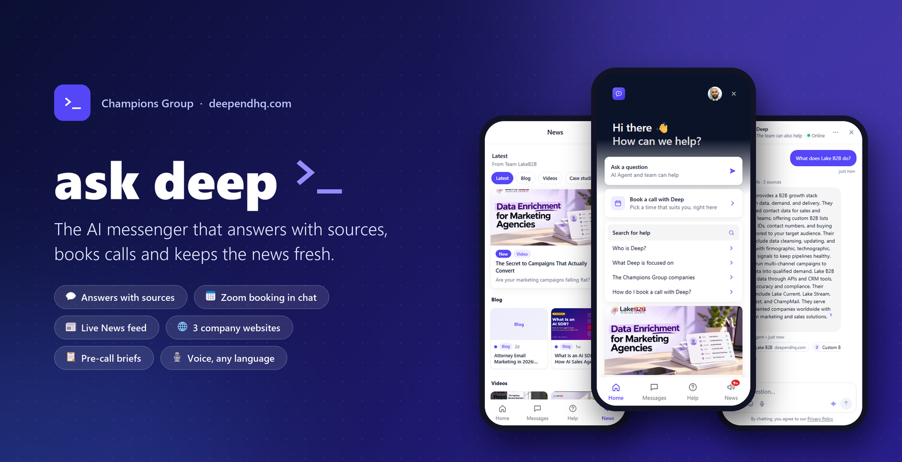
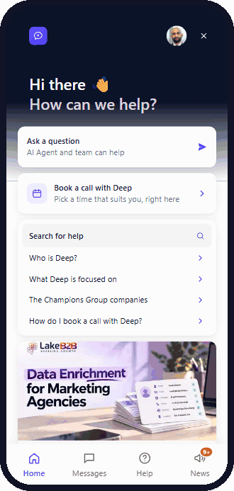
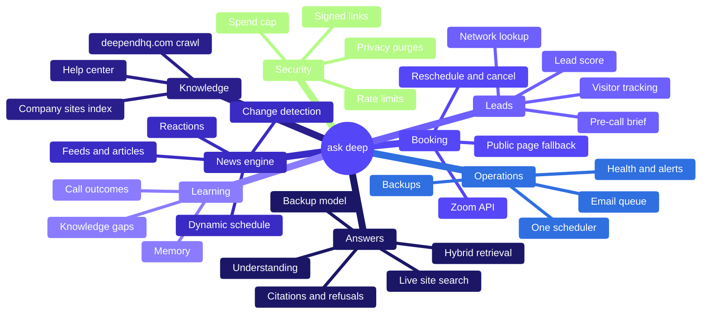
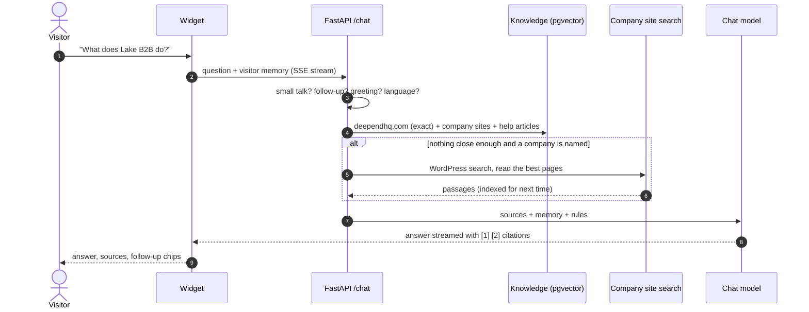
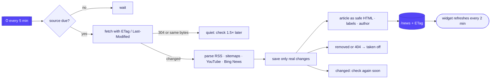
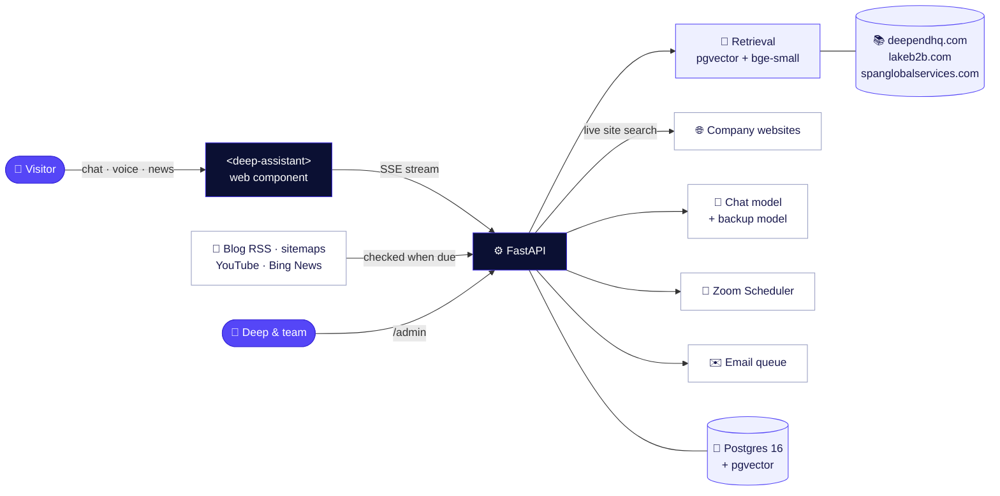

<div align="center">



<br><br>

<a href="#-quick-start"></a>
<a href="#-see-it-in-action"></a>
<a href="#-inside-the-backend"></a>
<a href="docs/FEATURES.md"></a>
<a href="docs/CONFIGURATION.md"></a>

<br>


</div>

<br>



<br>

**ask deep** is the assistant on [deependhq.com](https://deependhq.com) for Champions Group. It answers questions about
Deep and his companies from **deependhq.com, lakeb2b.com and spanglobalservices.com**, always with sources. It books
calls on Deep's Zoom calendar without leaving the chat, keeps a live **News** feed from every company, and hands Deep a
brief on each lead before the call.

## 🎬 See it in action

<table>
<tr>
<td width="42%" align="center" valign="top">

</td>
<td width="58%" valign="top">

<br>

**1 · Ask anything** &nbsp;—&nbsp; the visitor types in plain words, in any language.

**2 · Watch it think** &nbsp;—&nbsp; "Searching deependhq.com…", then the answer streams in word by word.

**3 · Check the sources** &nbsp;—&nbsp; every claim carries a numbered source: deependhq.com first, then the
company's own website.

**4 · Catch up on News** &nbsp;—&nbsp; a featured story and a sideways row per feed: Blog, Videos, Case studies,
Guides & papers, Announcements.

**5 · Read without leaving** &nbsp;—&nbsp; articles open inside the messenger, with labels, "Shared by", and
💜 😴 👎 🎉 reactions.

<br>

> [!TIP]
> Run it yourself in two commands: see **[Quick start](#-quick-start)**, then open `http://127.0.0.1:8080/site`.

</td>
</tr>
</table>

## ✨ What it does

<table>
<tr>
<td width="33%" valign="top">

### 💬 Answers with sources
Every answer cites the pages it came from. Off-topic questions get a polite "I'd rather not guess", never an
invented answer.

</td>
<td width="33%" valign="top">

### 🌐 Knows every company site
LakeB2B and SPAN are read page by page and kept fresh every few hours. Anything not indexed yet is searched
**live** on the company's own site.

</td>
<td width="33%" valign="top">

### 📅 Booking in the chat
Call type → date → time → confirm, with guests, a Zoom link and a calendar invite. Reschedule or cancel from the
chat or any email.

</td>
</tr>
<tr>
<td width="33%" valign="top">

### 📰 News, like Intercom
A featured story, a sideways row per feed, articles that open inside the chat, labels, "Shared by" and reactions.

</td>
<td width="33%" valign="top">

### ⚡ News that checks itself
Sources are checked again soon after they change and less often while quiet. Edited pages show **Updated**;
removed pages leave by themselves.

</td>
<td width="33%" valign="top">

### 🧭 Help center
Collections and articles in the Help tab, searchable by meaning, written from deependhq.com and editable by Deep.

</td>
</tr>
<tr>
<td width="33%" valign="top">

### 📋 Pre-call brief
Who they are, what they asked and read, where they came from, and a 0–100 lead score where every point is
backed by evidence.

</td>
<td width="33%" valign="top">

### 👥 Team replies in the chat
Answer from the console; the reply lands in the visitor's chat, and they get an email if they've left.

</td>
<td width="33%" valign="top">

### 📈 Learns every day
Unanswered questions become drafted answers to approve; call outcomes re-weight the lead score.

</td>
</tr>
<tr>
<td width="33%" valign="top">

### 🎙 Voice, any language
A mic button and a hands-free voice call; answers come back in the visitor's own language.

</td>
<td width="33%" valign="top">

### 🔔 Tells you when it breaks
Health checks on the model key, credit, database, email, backups and news sources, with an alert email.

</td>
<td width="33%" valign="top">

### 🛡 Safe and hard to lose
Rate limits, a spend cap, signed links, injection fences, sanitised HTML, nightly backups and a saved email queue.

</td>
</tr>
</table>

## 🧠 Inside the backend

<div align="center">


</div>

One FastAPI process does everything: the chat, the knowledge, the News engine, booking, email, the console and every
scheduled job. Postgres with pgvector holds all of it. There is no queue server and no separate worker to run.



### How one question is answered



### How News stays fresh



### Every part, in detail

<table>
<tr>
<td width="50%" valign="top">

#### 💬 Answering &nbsp;<sub>`chat.py` · `rag/`</sub>
- Small talk answered warmly, with varied replies; greetings stripped from real questions
- Follow-ups ("tell me more") rewritten into a standalone question
- **Hybrid search**: deependhq.com scored exactly, company sites through the HNSW index, help articles merged
- Pinned pages for day numbers, "latest", date ranges ("last week"), Deep's bio, tools, the company list
- A named company starts from its deependhq.com page and its own home and about pages
- At most 2 passages per company page; confidence floors decide answer, careful answer or refusal
- Stale sources dated "as of"; translation in and out for 20+ languages
- Prompt-injection fences on everything retrieved; a backup model if the first one fails
- Streamed over SSE with status steps, sources, cards and follow-up chips

</td>
<td width="50%" valign="top">

#### 📚 Knowledge &nbsp;<sub>`ingest/` · `sites.py` · `help.py`</sub>
- deependhq.com crawled nightly from `llms-full.txt`, `data.js` and the sitemap; unchanged pages skipped by hash
- **Company websites**: every sitemap page, robots.txt honoured, menus and footers removed, 5,600+ passages
- Incremental every 6 h by `lastmod`; removed pages leave; one pass at a time across processes (advisory lock)
- **Live search** through the site's own WordPress search, then indexed on the spot
- Local embeddings (`bge-small`, no API key), HNSW vector index in Postgres
- Help center: collections and articles embedded for search and for answers

</td>
</tr>
<tr>
<td width="50%" valign="top">

#### 📰 News engine &nbsp;<sub>`news.py`</sub>
- Per tenant: blog RSS, typed sitemaps, YouTube, Bing News mentions, hand-published posts
- **Adaptive schedule** per source (15 min → 24 h), conditional GET, body hashing
- Only real changes saved; "Updated" label; removed pages and dead links taken off and brought back
- Articles kept as sanitised HTML; labels from categories; "Shared by" from the author
- Feeds, featured story and rows per feed; per-item read state; launcher pop-up
- Reactions and views per item; mentions held for approval; "Find sources" from a URL

</td>
<td width="50%" valign="top">

#### 📅 Booking &nbsp;<sub>`booking/`</sub>
- Zoom Scheduler through the official API, a public-page fallback, or a browser worker
- Two-week availability grid; review and confirm; never "booked" until Zoom confirms
- Guests, `.ics` invites, a private manage page with two-step cancel
- Reschedule and cancel in the chat or from any email; join links fetched when Zoom sends them late
- Branded "Ledger" emails for every step, plus reminders the day before

</td>
</tr>
<tr>
<td width="50%" valign="top">

#### 🎯 Leads &amp; intelligence &nbsp;<sub>`tracking.py` · `network.py` · `precall.py`</sub>
- How each visitor arrived: direct, search, social, AI assistant, email, paid, campaign, UTM tags
- City, country and network owner of the IP (MaxMind GeoLite2 on the server, or ipwho.is)
- Network kind: company, home, mobile, cloud, VPN, coworking, university, government
- Email domains checked by website, MX and DNS; staff, test and throwaway addresses flagged
- **Evidence-based lead score** with a reason per point; hot-lead alerts; the host's booking page

</td>
<td width="50%" valign="top">

#### 🧠 Memory &amp; learning &nbsp;<sub>`session_memory.py` · `gaps.py` · `outcomes.py`</sub>
- Working memory per conversation; a short history across visits; never stores email addresses
- "Welcome back" with the last topic and upcoming calls; titled conversation history
- Unanswered questions → nightly drafted answers → one-click approve → the askers get an email
- Call outcomes (good fit, follow-up, not a fit, no-show) draft follow-ups and re-weight the score
- Custom answers and guidance written in the console take effect at once

</td>
</tr>
<tr>
<td width="50%" valign="top">

#### 👥 Team &amp; console &nbsp;<sub>`team.py` · `admin.html`</sub>
- Replies from the console appear in the visitor's chat; an email if they have left
- Conversation status (waiting, replied, closed) and visitor ratings
- Console: overview, conversations, bookings, gaps, sessions, guidance, custom answers, help center, news, emails, outreach
- Outreach rules ("45 s on the LakeB2B page → offer a walkthrough") and returning-visitor pop-ups

</td>
<td width="50%" valign="top">

#### 🔔 Reliability &nbsp;<sub>`health.py` · `backup.py` · `mailer.py` · `leader.py`</sub>
- Health checks every 10 min: model key, credit, answers, database, email, booking, backups, news sources
- Alert email on a problem, every 6 h while it lasts, and on recovery
- Nightly `pg_dump` (14 kept) with a one-command restore
- A saved email queue that resends after a crash; a backup chat model
- One scheduler runner across app instances (Postgres advisory lock)

</td>
</tr>
<tr>
<td width="50%" valign="top">

#### 🎙 Voice &amp; media &nbsp;<sub>`media.py`</sub>
- Browser speech recognition, or Whisper on the server with automatic language detection
- Spoken answers; a hands-free voice call view
- File attachments read into the answer; never followed as instructions

</td>
<td width="50%" valign="top">

#### 🛡 Security &amp; privacy &nbsp;<sub>`security/` · `identity.py` · `links.py`</sub>
- CORS allow-list, rate limits, a daily model spend cap, an admin token
- Signed-in visitors by HMAC token or Clerk JWT; signed one-tap email links
- Forwarding headers trusted only from known proxies; optional IP masking
- Retention purges for tracking, memory and email claims; EEA, UK, GPC and Do Not Track respected
- News HTML sanitised to a safe allow-list before it reaches the page

</td>
</tr>
</table>

### ⏱ Scheduled jobs &nbsp;<sub>all in-process, one runner across instances</sub>

**Every few minutes** &nbsp;


**Hourly** &nbsp;


**Nightly** &nbsp;


**Weekly** &nbsp;


<sub>Times are in the host's timezone (Asia/Kolkata). With `NEWS_DYNAMIC=false`, `news_tick` is replaced by fixed hourly and daily runs.</sub>

## 🏗 Architecture



<details>
<summary><b>📸 More screens</b>: one feed, an article, the help center and the console</summary>
<br>

<table>
<tr>
<td align="center" width="33%"><br><sub><b>One feed</b>: picture, label, age, title</sub></td>
<td align="center" width="33%"><br><sub><b>An article</b>: labels, "Shared by", reactions</sub></td>
<td align="center" width="33%"><br><sub><b>Help center</b>: written from deependhq.com</sub></td>
</tr>
</table>

<p align="center"><br><sub><b>Console → News</b>: every source with its last check, last change, next check and status</sub></p>

</details>

## 🚀 Quick start

**Needs:** Python 3.11+. Nothing else: no Docker, no Postgres install. An API key for a chat model
(e.g. a free Groq key) turns on generated answers; without one the assistant runs in quoted-text mode.

```bash
python -m venv .venv && .venv/Scripts/pip install -r requirements.txt   # macOS/Linux: .venv/bin/pip
.venv/Scripts/python -m app.launch                                       # Windows: double-click run.cmd instead
```

`app.launch` creates `.env` from `.env.example` if missing, starts an **embedded Postgres + pgvector**
(`pgserver`, data in `./data/pg`), creates the schema, crawls and embeds deependhq.com on the first run only
(~1 min; the local embedding model downloads once, ~130 MB), starts the server and opens the embed preview.
Run it again and the site data and chat history are still there. A busy port, a missing widget file or an
unreachable `DATABASE_URL` stop it with the fix spelled out.

Already have Postgres? Set `DATABASE_URL` in `.env` and the launcher uses it instead; the embedded database is
only for the case where nothing is configured. The embedded database is a real Postgres 16 process, one per
install: fine for a single server, not for several app instances sharing data (point them at one `DATABASE_URL`).

Then open:

| URL | What |
|---|---|
| http://127.0.0.1:8080 | the assistant, full screen |
| http://127.0.0.1:8080/site | the way deependhq.com shows it (launcher, greeting, quick replies) |
| http://127.0.0.1:8080/admin | owner console (needs `ADMIN_TOKEN`) |
| http://127.0.0.1:8080/demo | host-app demo with a signed-in user (`WIDGET_DEMO=true`) |
| http://127.0.0.1:8080/host/booking/sample | the host booking page filled with a sample booking |

<details>
<summary><b>Windows: one double-click</b></summary>

`run.cmd` creates `.venv` and installs the runtime requirements if they are missing, then runs `python -m app.launch`
(embedded database unless `DATABASE_URL` points at a reachable server). It uses the interpreter in `RUN_PYTHON`
from `.env`, else `.venv` in the project, passes `FASTEMBED_CACHE_PATH` from `.env` to the embedding model and sets
`OPENBLAS_NUM_THREADS=1` itself. `run.cmd -Docker` keeps the previous path: Docker Desktop → `docker compose up db`
→ uvicorn.

Tips: use `127.0.0.1` rather than `localhost` in `DATABASE_URL` (Docker Desktop's IPv6 relay stalls). On Windows
keep the project in a short path (`C:\deep-agent`): the local embedding stack installs files whose names exceed
Windows' 260-character limit under a long folder name, or enable long paths in Windows.
</details>

<details>
<summary><b>Docker / an existing Postgres</b></summary>

```bash
docker compose up --build -d          # Postgres 16 + pgvector, the app and the ingest job
docker compose run --rm ingest
```

or, with your own Postgres, set `DATABASE_URL` in `.env` and run `python -m app.ingest.pipeline` then
`uvicorn app.main:app --port 8080`. The MaxMind GeoLite2 files live in the `geoip` volume, so they survive rebuilds.
</details>

<details>
<summary><b>Models stay behind APIs</b></summary>

Chat always goes to the OpenAI-compatible endpoint in `LLM_BASE_URL` with `LLM_API_KEY`; the key lives on the
server and never reaches the widget. Without a key the assistant answers in **quoted-text mode**: the matching
page text with its sources, labelled as such, and no generated sentences. A provider timeout or rejected key
gives a labelled "having trouble answering" reply with the booking link and email, never a dead stream.

Embeddings are local by default (fastembed, no key). Set `EMBED_PROVIDER=api` with an `/embeddings`-capable
`EMBED_BASE_URL` and `EMBED_API_KEY` (defaults: the LLM ones) to keep them remote too; set `EMBED_DIM` for a model
the app doesn't know, and re-run the ingest after switching. OpenRouter has no embeddings endpoint.

Booking: with Zoom API credentials the meeting is created for real; otherwise the visitor gets a prefilled
Zoom hand-off link and the chat says so (`pending_zoom`). The widget never reports a meeting as booked unless a
provider confirmed it.
</details>

> [!NOTE]
> Every setting, the go-live checklist and deploying to a server: **[docs/CONFIGURATION.md](docs/CONFIGURATION.md)**.

## 🔌 Embed it

**On deependhq.com** (launcher bubble, greeting card):

```html
<script src="https://<assistant-host>/static/widget.js" defer></script>
```

**In any app** (React, Vue, Angular, plain HTML):

```html
<script type="module" src="https://<assistant-host>/static/deep-assistant.js"></script>
<deep-assistant api="https://<assistant-host>" mode="launcher" theme="auto"></deep-assistant>
```

Ready-made wrappers: [`widget/react/DeepAssistant.tsx`](widget/react/DeepAssistant.tsx) and
[`widget/vue/DeepAssistant.vue`](widget/vue/DeepAssistant.vue). The component fires `deep-assistant:*` events
(`ready`, `question`, `answer`, `booking`, `handover`, `ui`, …) for the host page's analytics. Swapping out the
current Widgo chat on deependhq.com is covered step by step in [WIDGET_SWAP](docs/WIDGET_SWAP.md).

## 🧪 Quality

<div align="center">


</div>

<details>
<summary><b>How to run every check</b></summary>
<br>

```bash
pip install -r requirements-dev.txt           # pytest, pytest-asyncio, respx (not part of the runtime install)
pytest                                        # 682 passed, 2 skipped; no network (the database tests skip without Postgres)
python scripts/eval_answers.py                # 43 real questions through the real index and model, each graded
node scripts/browser_check_widget.mjs http://127.0.0.1:8080 out   # the widget in a real headless browser
python -m app.tracking 49.207.200.10 'Acme' a@acme.com   # one IP through GEOIP_PROVIDER and the network rules, no database
python -m app.geoip_update                    # download or refresh the GeoLite2 files (needs MAXMIND_LICENSE_KEY)
LIVE=1 pytest tests/test_live_zoom.py -s      # real Zoom availability (read-only)
python scripts/verify_zoom.py                 # check Zoom S2S credentials once they are in .env
python scripts/preview_booking_email.py       # every booking email as HTML in email_preview/ (index.html), no SMTP
python scripts/send_test_emails.py you@outlook.com you@icloud.com   # the whole set to real inboxes ([test] subjects, sample data)
cd tools/openui && npm ci && npm test         # answer-card parser, renderer and email renderer
```

On a busy Windows machine set `OPENBLAS_NUM_THREADS=1` before running pytest.

</details>

## 🗂 Project layout

<details>
<summary><b>Where everything lives</b></summary>
<br>

```
app/
  main.py            FastAPI app, routes, CORS, startup checks, scheduler
  config.py          every setting, read from .env
  chat.py            understand → retrieve (+ live site search) → answer / refuse / book → SSE stream
  ingest/            deependhq.com crawler → chunks → embeddings
  sites.py           the company websites in the knowledge: sitemap index, live WordPress search
  news.py            the News tab: sources per tenant, dynamic checking, feeds, articles, reactions
  help.py            the help center: collections, articles, search
  rag/               retrieval, small talk and follow-ups, prompts, injection fences
  booking/           Zoom clients, in-chat booking flow, emails (text + branded HTML), .ics, browser booking
  team.py            team replies inside the visitor's chat, ratings, status
  precall.py         pre-call brief and the evidence-based lead score
  enrich.py          company from the email domain, and the DNS check of that domain
  outcomes.py        call outcomes, follow-up drafts, the learning lead score
  host_page.py       the host's private booking page
  links.py           signed one-tap email links, PUBLIC_BASE_URL checks
  gaps.py            unanswered questions → drafted answers → emails to the people who asked
  tracking.py        session rows, channel, IP lookup chain and cache, trusted proxies, retention purge
  network.py         who owns the network behind an IP, what kind it is, does it match the visitor's company
  geoip_update.py    MaxMind GeoLite2 download, checksum check and weekly refresh
  visitors.py        returning visitors who never chatted, organisations visiting
  outreach.py        greeting rules, returning-visitor pop-ups, the pop-up's DATA message
  email_ask.py       Ask Deep from booking emails: signed links, the claim, booking context, memory binding
  memory.py          return-visitor memory (greeting, HISTORY block)
  session_memory.py  working memory for each conversation (CURRENT CONVERSATION block)
  media.py           uploads, speech-to-text clean-up, text-to-speech
  health.py          health checks and alert emails
  backup.py          nightly pg_dump, keep 14, restore
  leader.py          one scheduler runner across app instances (advisory lock)
  mailer.py          email sending with the saved queue
  inbox.py, conversations.py, titles.py   stored turns, metrics, the visitor's past conversations
  identity.py        signed-in visitors (HMAC token or Clerk JWT)
  templates.py       editable email templates
  digest*.py, nudge.py, reminders.py, suggestions.py, lang.py, guidance.py, ui_cards.py   automations and behaviour
  security/          rate limit and daily spend cap
static/
  deep-assistant.js  the <deep-assistant> web component (Home, Messages, Help, News, chat)
  widget.js          the deependhq.com launcher (device id, greeting rules, pop-ups)
  admin.html         owner console
  email/             booking-email icons and hero image
  deep-ui.js, deep-ui-lib.mjs, vendor/   answer-card renderer
widget/              React and Vue wrappers
scripts/             start-up, Zoom worker and check, email preview, answer check, browser tests
tools/openui/        answer-card toolchain and digest email renderer (Node)
tests/               pytest suite and the answer-check questions (tests/eval/)
docs/                guides (below) and the README images
data/geoip/          GeoLite2 files, downloaded at runtime (not in git)
```

</details>

## 📚 Documentation

<table>
<tr>
<td width="33%" valign="top">

**📘 [Features](docs/FEATURES.md)**<br>
<sub>every feature in detail: answers, booking, emails, the brief and lead score, tracking, memory, voice, privacy</sub>

</td>
<td width="33%" valign="top">

**⚙️ [Configuration](docs/CONFIGURATION.md)**<br>
<sub>every setting in `.env`, the go-live checklist, deploying and the scheduled jobs</sub>

</td>
<td width="33%" valign="top">

**🗺 [Roadmap](docs/ROADMAP.md)**<br>
<sub>what is done and what comes next</sub>

</td>
</tr>
<tr>
<td valign="top">

**🧩 [Widget](docs/WIDGET.md)** · [Swap](docs/WIDGET_SWAP.md)<br>
<sub>the web component: attributes, events, identity, theming; replacing Widgo on deependhq.com</sub>

</td>
<td valign="top">

**📅 [Booking](docs/BOOKING.md)** · [Browser](docs/BROWSER_BOOKING.md) · [Zoom](docs/ZOOM_SETUP.md) · [Failures](docs/FAILURE_MODES.md)<br>
<sub>in-chat booking, the public-page path, the Zoom app, every failure and its fallback</sub>

</td>
<td valign="top">

**✉️ [Emails](docs/EMAILS.md)** · [Automations](docs/AUTOMATIONS.md)<br>
<sub>every email and its wording; digest, nudges, reminders, the brief, gaps, outcomes</sub>

</td>
</tr>
<tr>
<td valign="top">

**🧠 [Memory & voice](docs/MEMORY_VOICE.md)**<br>
<sub>working memory, history, multilingual voice</sub>

</td>
<td valign="top">

**🎯 [Outreach](docs/OUTREACH.md)** · [Tracking](docs/TRACKING.md)<br>
<sub>greeting rules, returning visitors; IP lookup, networks, retention, privacy</sub>

</td>
<td valign="top">

**🎨 [Design](docs/DESIGN.md)** · [Agent UI](docs/AGENT_UI.md) · [Cards](docs/UI_CARDS.md)<br>
<sub>the visual spec, streaming and the voice view, answer cards</sub>

</td>
</tr>
</table>

<br>

<div align="center">

<sub>Private and proprietary · © Champions Group</sub>
</div>
