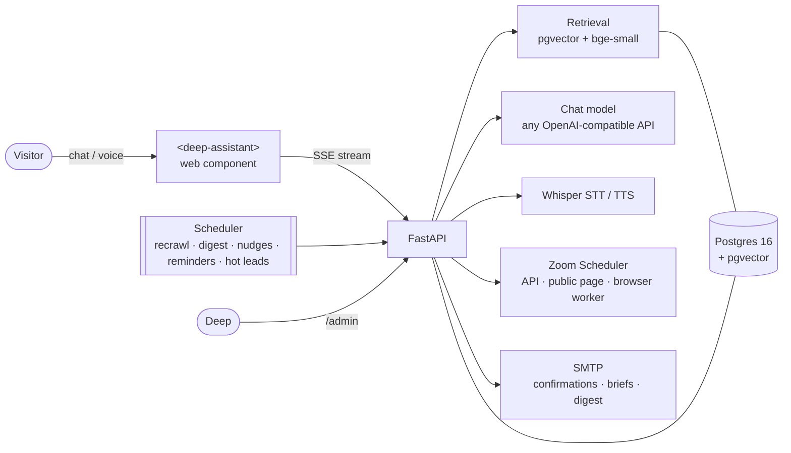

<div align="center">

# ask deep `>_`

**The AI assistant for [deependhq.com](https://deependhq.com).**
It answers questions about Deep's companies with sources, books calls on Deep's Zoom calendar inside the chat, and
gives Deep a brief on every lead before the call.


[Features](#features) · [Quick start](#quick-start) · [Configuration](#configuration) · [Embed it](#embed-it) ·
[Deploy](#deploy) · [Tests](#tests) · [Docs](#documentation)

</div>

---

## Features

| | |
|---|---|
| **Answers with sources** | Retrieval over the crawled deependhq.com (llms-full.txt, data.js, sitemap pages), with a confidence floor: off-topic questions get a polite refusal instead of a guess. Prompt-injection fences on everything retrieved. |
| **Booking in the chat** | Call type → date → time → details → confirm. The visitor can add attendees and gets a Zoom link and an `.ics` invite. Reschedule, cancel and "book again" also work from the chat. Uses Zoom's official API, a public-page fallback, or a browser worker on the public scheduler page. |
| **Pre-call brief and lead score** | Before every call Deep gets a brief: who they are, what they asked, pages they read, where they came from and a 0–100 score with reasons. Hot leads trigger an alert. |
| **Voice in any language** | A mic button and a hands-free voice call. Server speech-to-text (Whisper) detects the language automatically. It ignores silence and noise and re-reads text written in the wrong alphabet. Answers are spoken back. |
| **Answer cards** | Comparisons, KPI tiles, timelines and next-step buttons rendered under the answer (openui-lang, sandboxed). |
| **Remembers return visitors** | "Welcome back" with the last topic, upcoming bookings, and a conversation history page. |
| **Proactive outreach** | Rules written in the console decide when the greeting speaks up ("45 s on the LakeB2B page → offer a walkthrough"). |
| **Automations** | Weekly digest email, follow-up nudges, reminders the day before, lead enrichment and smart suggestions. All of it runs in the same process. |
| **Owner console** (`/admin`) | Conversations, bookings with briefs, knowledge gaps, guidance, custom answers, outreach rules, email templates and metrics. |
| **Embeds anywhere** | A single dependency-free web component (`<deep-assistant>`) in Shadow DOM. Wrappers for React/Next.js and Vue. Signed-in identity via HMAC token or Clerk JWT. |
| **Safe by default** | CORS allow-list, rate limits, a daily spend cap, an admin token and optional IP masking for session tracking. |

## How it works



Embeddings run locally (`BAAI/bge-small-en-v1.5` via fastembed: no key, no cost). The chat model is any
OpenAI-compatible endpoint: Groq's free tier, OpenRouter or OpenAI.

## Quick start

**Needs:** Python 3.11, Docker (for Postgres), and an API key for a chat model (e.g. a free Groq key).

```bash
cp .env.example .env                 # fill LLM_API_KEY; outside Docker use DATABASE_URL=...@127.0.0.1:5432/...
docker compose up -d db              # Postgres 16 + pgvector
python -m venv .venv
.venv/Scripts/pip install -r requirements.txt        # macOS/Linux: .venv/bin/pip
python -m app.ingest.pipeline        # crawl + embed deependhq.com (~1 min; first run downloads the 130 MB model)
uvicorn app.main:app --port 8080 --reload
```

Then open:

| URL | What |
|---|---|
| http://localhost:8080 | the assistant, full screen |
| http://localhost:8080/site | the way deependhq.com shows it (launcher, greeting, quick replies) |
| http://localhost:8080/admin | owner console (needs `ADMIN_TOKEN`) |
| http://localhost:8080/demo | host-app demo with a signed-in user (`WIDGET_DEMO=true`) |

<details>
<summary><b>Windows: one double-click</b></summary>

`run.cmd` starts Docker Desktop if needed, waits for Postgres to be healthy and starts the assistant on port 8080.
It uses `.venv` in the project, or the interpreter in `RUN_PYTHON` from `.env`, and passes `FASTEMBED_CACHE_PATH` from
`.env` to the embedding model.

Tips: use `127.0.0.1` rather than `localhost` in `DATABASE_URL` (Docker Desktop's IPv6 relay stalls), and set
`OPENBLAS_NUM_THREADS=1` if numpy runs out of memory on a busy machine.
</details>

<details>
<summary><b>Everything in Docker</b></summary>

```bash
docker compose up --build -d
docker compose run --rm ingest
```
</details>

## Configuration

All settings live in `.env`. `.env.example` lists every option with a comment. These are the main ones:

| Setting | Purpose |
|---|---|
| `LLM_API_KEY`, `LLM_BASE_URL`, `CHAT_MODEL` | the chat model (Groq, OpenRouter, OpenAI…) |
| `DATABASE_URL` | Postgres with the `vector` extension |
| `ALLOWED_ORIGINS` | sites allowed to embed the assistant (no wildcard) |
| `ADMIN_TOKEN` | protects `/admin` and every `/admin/*` endpoint |
| `ZOOM_BOOKING_BASE`, `ZOOM_*` | Deep's scheduler page; S2S OAuth credentials for the official API ([ZOOM_SETUP](docs/ZOOM_SETUP.md)) |
| `SMTP_*`, `HOST_EMAIL` | confirmation emails, host briefs, digest |
| `STT_PROVIDER`, `TTS_PROVIDER` | `browser` or `openai` (any `/audio/*` endpoint, e.g. Groq Whisper) |
| `BROWSER_BOOKING_ENABLED`, `JEV_PYTHON` | booking on the public Zoom page by a browser worker ([BROWSER_BOOKING](docs/BROWSER_BOOKING.md)) |
| `WIDGET_SIGNING_SECRET`, `CLERK_JWT_ISSUER_DOMAIN` | signed-in visitors from a host app ([WIDGET](docs/WIDGET.md)) |
| `PRECALL_*`, `HOT_LEAD_*`, `DIGEST_*` | briefs, lead alerts and the weekly digest ([AUTOMATIONS](docs/AUTOMATIONS.md)) |

> [!IMPORTANT]
> Never commit `.env`; it is in `.gitignore`. Set long random values for `ADMIN_TOKEN` and `WIDGET_SIGNING_SECRET`
> in production.

## Embed it

**On deependhq.com** (launcher bubble, greeting card):

```html
<script src="https://<assistant-host>/static/widget.js" defer></script>
```

**In any app** (React, Vue, Angular, plain HTML):

```html
<script type="module" src="https://<assistant-host>/static/deep-assistant.js"></script>
<deep-assistant api="https://<assistant-host>" mode="launcher" theme="auto"></deep-assistant>
```

Ready-made wrappers: [`widget/react/DeepAssistant.tsx`](widget/react/DeepAssistant.tsx) and
[`widget/vue/DeepAssistant.vue`](widget/vue/DeepAssistant.vue). The component fires `deep-assistant:*` events
(`ready`, `question`, `answer`, `booking`, `handover`, `ui`, …) for the host page's analytics. Swapping out the
current Widgo chat on deependhq.com is covered step by step in [WIDGET_SWAP](docs/WIDGET_SWAP.md).

## Deploy

```bash
gcloud run deploy deependhq-assistant --source . --region asia-south1 \
  --set-env-vars-from-file .env.yaml --min-instances 1 --max-instances 2
```

* `--min-instances 1` keeps the scheduler (recrawl, digest, reminders, alerts) and the rate limiter alive. It runs a
  single worker on purpose.
* The database is Cloud SQL (Postgres 16 + `vector`) or Neon. The image bakes in the embedding model and Node for the
  rich digest.
* App Runner, ECS or any Docker host run the same image with the same env.
* Point DNS for `<assistant-host>` at the service, set `ALLOWED_ORIGINS` to the site's origins and run the ingest once.

### Scheduled jobs (in-process)

| When | Job |
|---|---|
| `RECRAWL_CRON` (02:30 IST) | re-crawl and re-embed deependhq.com |
| `DIGEST_CRON` (Mon 09:00) | weekly digest email to Deep |
| hourly :15 | one follow-up email to visitors who started a booking on Zoom but didn't confirm |
| hourly :30 | hot-lead alerts |
| hourly :45 | booking reminders and pre-call briefs |
| daily 03:10 | purge old tracking data |

## Tests

```bash
pytest                                        # 237 tests, no network, no database
LIVE=1 pytest tests/test_live_zoom.py -s      # real Zoom availability (read-only)
python scripts/verify_zoom.py                 # check Zoom S2S credentials once they are in .env
node scripts/browser_check_widget.mjs http://127.0.0.1:8080 out   # the widget in a real headless browser
cd tools/openui && npm ci && npm test         # answer-card parser, renderer and email renderer
```

## Project layout

```
app/
  main.py          FastAPI app, routes, CORS, scheduler
  chat.py          retrieve → answer / refuse / book → SSE stream
  ingest/          crawler → chunks → embeddings
  rag/             retrieval with a confidence floor, prompts, injection fences
  booking/         Zoom clients, in-chat booking flow, emails, .ics, browser booking
  precall.py       pre-call brief and lead score
  media.py         uploads, speech-to-text clean-up, text-to-speech
  memory.py        return-visitor memory
  outreach.py      proactive greeting rules
  digest*.py, nudge.py, reminders.py, enrich.py, suggestions.py   automations
  security/        rate limit and daily spend cap
static/
  deep-assistant.js   the <deep-assistant> web component
  widget.js           the deependhq.com launcher
  admin.html          owner console
  deep-ui*.js, vendor/   answer-card renderer
widget/            React and Vue wrappers
scripts/           run.ps1 (Windows start), Zoom browser worker, Zoom check, browser tests
tools/openui/      answer-card toolchain and digest email renderer (Node)
tests/             pytest suite
docs/              feature guides (below)
```

## Documentation

| Guide | Covers |
|---|---|
| [WIDGET](docs/WIDGET.md) | the web component: attributes, events, identity, theming |
| [WIDGET_SWAP](docs/WIDGET_SWAP.md) | replacing Widgo on deependhq.com |
| [BOOKING](docs/BOOKING.md) | in-chat booking, attendees, reschedule, cancel |
| [BROWSER_BOOKING](docs/BROWSER_BOOKING.md) | booking on the public Zoom page without API credentials |
| [ZOOM_SETUP](docs/ZOOM_SETUP.md) | Zoom Server-to-Server OAuth app |
| [FAILURE_MODES](docs/FAILURE_MODES.md) | every booking failure and its fallback |
| [AUTOMATIONS](docs/AUTOMATIONS.md) | digest, nudges, reminders, enrichment, pre-call briefs, lead alerts |
| [EMAILS](docs/EMAILS.md) | every email, who gets it, how to change the wording |
| [MEMORY_VOICE](docs/MEMORY_VOICE.md) | return-visitor memory, multilingual voice and its accuracy |
| [OUTREACH](docs/OUTREACH.md) | proactive greeting rules |
| [TRACKING](docs/TRACKING.md) | session origin tracking and privacy |
| [UI_CARDS](docs/UI_CARDS.md) | answer cards (openui-lang) |
| [AGENT_UI](docs/AGENT_UI.md) | activity row, streaming, the orb, the voice call view |
| [DESIGN](docs/DESIGN.md) | visual design spec |

---

<div align="center">
<sub>Built for <b>Champions Group</b> · deependhq.com · Private and proprietary</sub>
</div>
