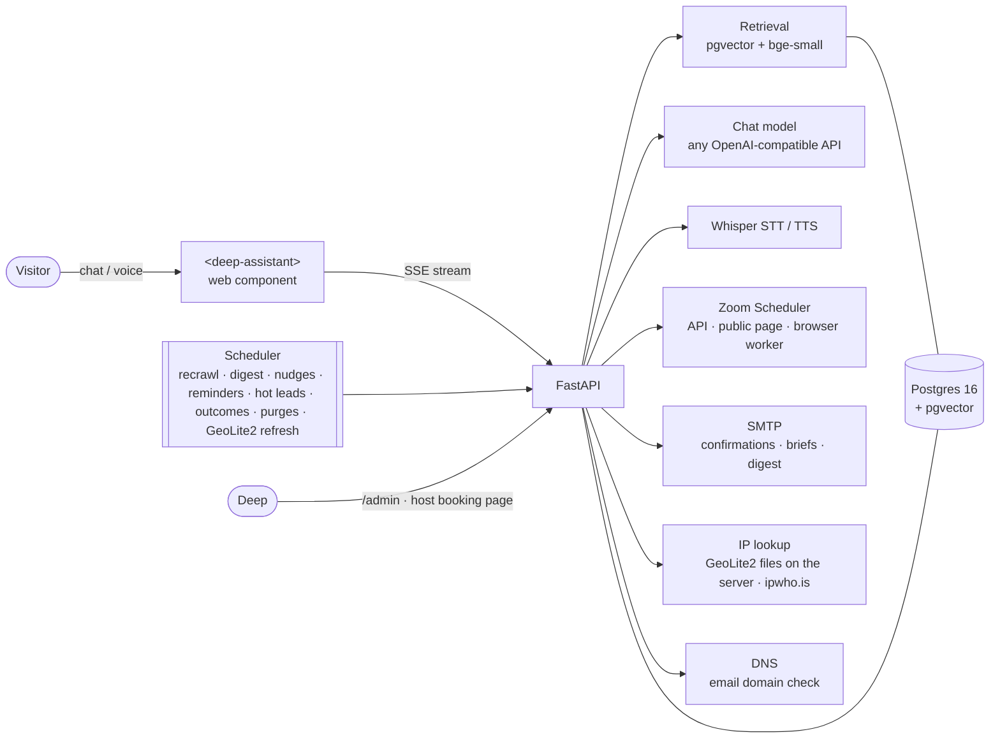

<div align="center">

# ask deep `>_`

**The AI assistant for [deependhq.com](https://deependhq.com).**
It answers questions about Deep's companies with sources, books calls on Deep's Zoom calendar inside the chat, and
gives Deep a brief on every lead before the call.


[Features](#features) · [Features in detail](#features-in-detail) · [Quick start](#quick-start) ·
[Configuration](#configuration) · [Visitor tracking and IP lookup](#visitor-tracking-and-ip-lookup) ·
[Go-live checklist](#go-live-checklist) · [Embed it](#embed-it) · [Deploy](#deploy) ·
[Scheduled jobs](#scheduled-jobs-in-process) · [Tests](#tests) · [Docs](#documentation)

</div>

---

## Features

| | |
|---|---|
| **Answers with sources** | Retrieval over the crawled deependhq.com (llms-full.txt, data.js, sitemap pages), with a confidence floor: off-topic questions get a polite refusal instead of a guess. Prompt-injection fences on everything retrieved. |
| **Booking in the chat** | Call type → date → time → details → confirm. The visitor can add guests and gets a Zoom link and an `.ics` invite. Reschedule, cancel and "book again" also work from the chat, and every email carries a private manage page with a two-step cancel. Uses Zoom's official API, a public-page fallback, or a browser worker on the public scheduler page. |
| **Branded booking emails** | Every booking email (confirmation, new booking, cancelled, moved, reminders, the host's day-before brief, guest notes) comes in one HTML design, "Ledger", with a plain-text part that stays editable in the console. No images: it reads the same with images blocked and in dark mode. |
| **Ask Deep from every email** | Visitor and guest booking emails end with one-tap questions that open the assistant already knowing that booking. The booker's earlier website chats join the memory on whatever device they open it on; guests stay separate. |
| **Pre-call brief and lead score** | Before every call Deep gets a brief: who they are, what they asked, pages they read, where they came from and a 0–100 score with a reason for every point. Hot leads who never booked trigger an alert. |
| **Honest lead score** | Points come only from evidence the visitor cannot simply type: a company email whose domain was checked (website, MX record or DNS), the network matching their company, what they did on the site. What they only typed (company, role, budget) is listed as a claim and scores 0. Staff, test, competitor and throwaway addresses are flagged. Every line says whether it is *checked*, *seen* or a *warning*, and a thin record reads "Not enough data yet" instead of "Cold". |
| **Host booking page** | "View booking details" in Deep's emails opens a private, phone-friendly page: status, lead score, join link, who they are, where they came from, the brief, the whole chat and earlier visits. Signed link bound to the booking, read-only on open (mail scanners click everything), never shows IPs or the visitor's manage links. |
| **Visitor tracking and network lookup** | Every chat session gets a row recording how the visitor arrived (direct, search, social, AI assistant, email, paid, campaign, referral, with UTM tags), the city and country of their IP, and the network behind it: its owner and kind (company, home or mobile broadband, cloud, VPN or relay, coworking, university, government). The brief says whether that network matches the company they typed or their email domain. Works with no API key; a MaxMind key keeps every lookup on the server ([below](#visitor-tracking-and-ip-lookup)). |
| **Returning visitors who never chatted** | The greeting can recognise a returning browser and, on a company network or by country, offer a pop-up such as "Exploring B2B data for Acme?". The IP is never stored for this; the EEA, UK and Switzerland, Global Privacy Control and Do Not Track are excluded by default. A company is named only after 2+ visits from its network or the owner's approval in the console, where any organisation can be switched off. |
| **Working memory** | Within a conversation the bot keeps a structured memory of what the visitor said (needs, region, volume, timeline, tools) and, across visits, a short history, so a long chat or a return visit never starts from zero. Email addresses are never stored in it. |
| **Learns from unanswered questions** | Every night the questions the bot couldn't answer become drafted answers. Deep approves one with a click, the bot answers it from then on, and the people who asked get the answer by email. |
| **Learns from every call** | After each call Deep taps Good fit / Follow up / Not a fit / No-show. The bot drafts the follow-up email, and the lead score re-weights its rules from real outcomes. |
| **Voice in any language** | A mic button and a hands-free voice call. The browser's own speech recognition by default, or server speech-to-text (Whisper, `STT_PROVIDER=openai`) that detects the language automatically, ignores silence and noise and re-reads text written in the wrong alphabet. Answers are spoken back. |
| **Answer cards** | Comparisons, KPI tiles, timelines and next-step buttons rendered under the answer (openui-lang, sandboxed). |
| **Remembers return visitors** | "Welcome back" with the last topic, upcoming bookings, and a conversation history page. |
| **Proactive outreach** | Rules written in the console decide when the greeting speaks up ("45 s on the LakeB2B page → offer a walkthrough"). |
| **Automations** | Weekly digest email, follow-up nudges, reminders the day before, lead enrichment and smart suggestions. All of it runs in the same process. |
| **Owner console** (`/admin`) | Overview, conversations (with each one's memory), bookings with briefs and outcomes, knowledge gaps, sessions, guidance, custom answers, email templates and outreach (rules and organisations visiting). |
| **Embeds anywhere** | A single dependency-free web component (`<deep-assistant>`) in Shadow DOM. Wrappers for React/Next.js and Vue. Signed-in identity via HMAC token or Clerk JWT. |
| **Safe by default** | CORS allow-list, rate limits, a daily spend cap, an admin token, signed one-tap email links, forwarding headers believed only from trusted proxies, optional IP masking and retention purges for tracking data and memory. |

## How it works



Embeddings run locally (`BAAI/bge-small-en-v1.5` via fastembed: no key, no cost). The chat model is any
OpenAI-compatible endpoint: Groq's free tier, OpenRouter or OpenAI.

## Quick start

**Needs:** Python 3.11+. Nothing else: no Docker, no Postgres install. An API key for a chat model
(e.g. a free Groq key) turns on generated answers; without one the assistant runs in quoted-text mode.

```bash
python -m venv .venv && .venv/Scripts/pip install -r requirements.txt   # macOS/Linux: .venv/bin/pip
.venv/Scripts/python -m app.launch                                       # Windows: double-click run.cmd instead
```

`app.launch` creates `.env` from `.env.example` if missing, starts an **embedded Postgres + pgvector**
(`pgserver`, data in `./data/pg`), creates the schema, crawls and embeds deependhq.com on the first run only
(~1 min; the local embedding model downloads once, ~130 MB), starts the server and opens the embed preview.
Run it again and the site data and chat history are still there. A busy port, a missing widget file or an
unreachable `DATABASE_URL` stop it with the fix spelled out.

Already have Postgres? Set `DATABASE_URL` in `.env` and the launcher uses it instead; the embedded database is
only for the case where nothing is configured. The embedded database is a real Postgres 16 process, one per
install: fine for a single server, not for several app instances sharing data (point them at one `DATABASE_URL`).

Then open:

| URL | What |
|---|---|
| http://localhost:8080 | the assistant, full screen |
| http://localhost:8080/site | the way deependhq.com shows it (launcher, greeting, quick replies) |
| http://localhost:8080/admin | owner console (needs `ADMIN_TOKEN`) |
| http://localhost:8080/demo | host-app demo with a signed-in user (`WIDGET_DEMO=true`) |
| http://localhost:8080/host/booking/sample | the host booking page filled with a sample booking |

<details>
<summary><b>Windows: one double-click</b></summary>

`run.cmd` creates `.venv` and installs the runtime requirements if they are missing, then runs `python -m app.launch`
(embedded database unless `DATABASE_URL` points at a reachable server). It uses the interpreter in `RUN_PYTHON`
from `.env`, else `.venv` in the project, passes `FASTEMBED_CACHE_PATH` from `.env` to the embedding model and sets
`OPENBLAS_NUM_THREADS=1` itself. `run.cmd -Docker` keeps the previous path: Docker Desktop → `docker compose up db`
→ uvicorn.

Tips: use `127.0.0.1` rather than `localhost` in `DATABASE_URL` (Docker Desktop's IPv6 relay stalls). On Windows
keep the project in a short path (`C:\deep-agent`): the local embedding stack installs files whose names exceed
Windows' 260-character limit under a long folder name, or enable long paths in Windows.
</details>

<details>
<summary><b>Docker / an existing Postgres</b></summary>

```bash
docker compose up --build -d          # Postgres 16 + pgvector, the app and the ingest job
docker compose run --rm ingest
```

or, with your own Postgres, set `DATABASE_URL` in `.env` and run `python -m app.ingest.pipeline` then
`uvicorn app.main:app --port 8080`. The MaxMind GeoLite2 files live in the `geoip` volume, so they survive rebuilds.
</details>

<details>
<summary><b>Models stay behind APIs</b></summary>

Chat always goes to the OpenAI-compatible endpoint in `LLM_BASE_URL` with `LLM_API_KEY`; the key lives on the
server and never reaches the widget. Without a key the assistant answers in **quoted-text mode**: the matching
page text with its sources, labelled as such, and no generated sentences. A provider timeout or rejected key
gives a labelled "having trouble answering" reply with the booking link and email, never a dead stream.

Embeddings are local by default (fastembed, no key). Set `EMBED_PROVIDER=api` with an `/embeddings`-capable
`EMBED_BASE_URL` and `EMBED_API_KEY` (defaults: the LLM ones) to keep them remote too; set `EMBED_DIM` for a model
the app doesn't know, and re-run the ingest after switching. OpenRouter has no embeddings endpoint.

Booking: with Zoom API credentials the meeting is created for real; otherwise the visitor gets a prefilled
Zoom hand-off link and the chat says so (`pending_zoom`). The widget never reports a meeting as booked unless a
provider confirmed it.
</details>

## Features in detail

Each part below says what the feature does, how it works, what Deep and the visitor see, and which settings control
it. The linked guides in `docs/` go further.

### Answers with sources

Every night (`RECRAWL_CRON`, 02:30 IST) the crawler reads deependhq.com (llms-full.txt, data.js and the sitemap
pages), splits it into chunks and embeds them locally. A question is embedded the same way and matched against those
chunks. Before searching, the message is read (`app/rag/understand.py`): small talk ("hello", "how r u", "thanks", "what
can you do?", "is this a bot?") gets a short natural reply the model writes with the conversation in view (never a
word-for-word repeat; varied built-in replies when the model is down), with no search; a greeting in front of a question is dropped; a follow-up
("tell me more", "how is it different from Ampliz?") is rewritten into a standalone question. Questions vectors answer
badly go straight to the page that answers them: who Deep is and where he's based (home page and /now), his tools
(/toolkit), what he's on right now (/now), the full company list (the pillars page plus the exact count of company
pages, so "which companies?" never stops at the top six matches), and the latest entries. A question that names a period
("this week", "last month", "in September", "on October 5", "yesterday") gets the log entries and weekly essays dated in
it, in the visitor's calendar; when there is none yet, the bot says so and gives the newest entry. Every source carries
its date, and a page last updated more than 30 days ago is marked not current, so the June Now page is quoted "as of
June 12", never as today. Between `RETRIEVAL_SOFT_FLOOR` and `RETRIEVAL_MIN_SCORE` the model reads the loosely
related pages and either answers with citations or says it couldn't find it (an uncited answer is logged as a refusal).
If nothing is even that close, the bot politely says it can't answer instead of guessing,
and the question goes to the [knowledge-gap loop](#knowledge-gap-loop). Answers cite their pages. Everything retrieved
is fenced as data, so text on a page cannot give the model instructions. Deep can steer the bot without code changes:
**Guidance** (standing instructions) and **Custom answers** (an exact answer that fires word for word above
`CUSTOM_ANSWER_MIN_SCORE`) are both in the console. Non-English questions are answered in the visitor's language
(`MULTILINGUAL`).

### Booking in the chat, and the visitor's manage page

"Book a call" opens a card in the chat: call type, date, time, details (name, email, company, a note, up to five
guests), confirm. Open times come live from Deep's Zoom Scheduler page (`ZOOM_BOOKING_BASE`). The booking goes through
Zoom's API when Server-to-Server credentials are set together with `ZOOM_ENABLE_API_BOOKING=true` (Scheduler API) or
`ZOOM_HOST_USER_ID` (Meetings API); otherwise a browser worker books on the public page (`BROWSER_BOOKING_ENABLED`),
and when none of these is on or all fail, the time is held and the visitor confirms on Zoom with their details already
filled in. One email address can hold at most `BOOKING_MAX_ACTIVE_PER_EMAIL` upcoming bookings.

Zoom's public pages never show the join link, so for browser bookings the worker adds one mailbox of ours as a guest
on Zoom (`ZOOM_LINK_MAILBOX`, default `SMTP_USER`), and the app reads Zoom's invitation there over IMAP: the join link,
meeting ID and passcode go on the booking, and the confirmation emails (which wait up to `ZOOM_LINK_WAIT_SECONDS` for
it) carry the Join button and the phone row. No Zoom credentials ([BROWSER_BOOKING](docs/BROWSER_BOOKING.md#the-join-link-appbookingzoom_mailpy-2026-10-15)).

The visitor gets a confirmation email with the join link and an `.ics` invite; guests get their own short note.
Moving or cancelling works from the chat ("reschedule my call") and from the email's **View booking details** button,
which opens the visitor's private manage page (`/booking/{id}/manage`, opened with the booking's own private token). Its
cancel takes two steps: **Cancel this booking…** opens "Cancel this booking?" and only **Yes, cancel it** cancels, so a
mail scanner, an old email or a mis-tap cannot cancel a call. Details: [BOOKING](docs/BOOKING.md),
[FAILURE_MODES](docs/FAILURE_MODES.md).

### Booking emails

Every booking-lifecycle email (the visitor's confirmation, Deep's "New booking", cancelled, moved, the day-before
reminders, Deep's day-before brief, the 24 h reminder for an unconfirmed Zoom hold, and the notes to extra guests) is
HTML in one design system, "Ledger" (`app/booking/email_html.py`): a status pill, the heading, an event card with a
live-text date tile, before-and-after times for a move, and bulletproof buttons, built from the real booking: a
"Confirmed" pill and the join link once Zoom has created the meeting, "Awaiting Zoom confirmation" and the prefilled
Zoom link while it is only held. The plain-text part is always sent too and stays the editable template in
**Console → Emails**. The design uses no images, so blocked images change nothing; it has its own dark mode.

`EMAIL_ASSETS_URL` (hosted images, or empty to embed them in each message) is kept for a future email that needs
images; no current email uses one. Every email, who receives it and how to change the wording: [EMAILS](docs/EMAILS.md).

### Ask Deep from a booking email

Emails cannot run a chat (mail apps block scripts), so every email to a visitor or a guest (confirmation, cancelled,
moved, the day-before reminder, the 24 h Zoom reminder, and the four guest notes) ends with a small **Ask Deep** panel:
two to four one-tap questions that fit that email and its state ("How should I prepare for this call?", "How do I
confirm my time on Zoom?", "Book a new time"…) and "Open the assistant". Deep's own emails have no panel.

- **The link** opens the assistant (`/ask`) with a signed token in the URL fragment, so it never reaches a server log.
  The token is tied to one booking, one recipient and that email; it expires `EMAIL_ASK_TTL_DAYS` after the call, and
  rotating the booking's manage token revokes it. The page exchanges it with `POST /ask/claim`.
- **Mail scanners open links**: a plain fetch of `/ask` reads and writes nothing. The tapped question is sent only
  once the page is really open in a browser, once per link and question, and it is stored as sent by the page, not typed.
- **The conversation knows the booking**: call, time in the visitor's timezone, status (confirmed / waiting for Zoom /
  cancelled), guests' first names. It goes to the model as a DATA block, read live every turn.
- **Memory**: on another device (their phone), the booker's earlier website chats join that device's memory, and later
  website visits there carry on. One way only: the phone reads the laptop's history, never the reverse. A browser other
  people used gets the booking context but no history. With `EMAIL_ASK_TARGET=site` the link opens deependhq.com's
  own widget, so on the same browser it is simply the same memory.
- **Booker vs guest**: the booker can reschedule or cancel from that chat; a guest can ask questions but never change
  the booking, and never sees the booker's address, notes or chats.
- **Lead score**: opening a link or tapping a question earns nothing. A message the booker actually types in such a
  chat is `email_ask_chat`, +3, seen.
- **Analytics**: opens, taps and typed chats per email in `/admin/metrics` (`email_ask`); opens may include scanners.

### Pre-call brief and the honest lead score

Before every call Deep gets a one-page brief on the person (`app/precall.py`), built only from what the assistant
already stores; no paid data. It gathers every chat session of that person (the booking's, every session of the same
browser and every session tied to the same email), then lists the questions they typed, the pages they opened the chat
on, how they arrived, where they were and on which network, earlier bookings and cancellations, the company read off
their email domain, their note and guests. One model call (`PRECALL_MODEL`) turns those facts into a short summary,
talking points, questions to ask and watch-outs; when the model is off, slow or unusable, a rule-based brief from the
same facts is used, so a brief always exists.

**The score** starts at 10 and runs from 0 to 100. Hot is 60+, warm 35+, otherwise cold. Every rule has an evidence
class, and every "Why this score" line ends with its tag:

* **checked**: compared against something the visitor cannot simply type (their email domain's website or mail
  server, their network, a verified sign-in, an earlier call Deep rated);
* **seen**: something the system watched them do (questions, visits, pages, call type);
* **their word** (a claim): something they only typed. Company, role, budget, volume, timeline, team size and tools
  are shown under "What they say (not scored)" and earn **0 points**;
* **warning**: a sign that needs a look. These also appear as flags at the top of WATCH OUT.

The main rules (the full table is in [AUTOMATIONS §12](docs/AUTOMATIONS.md)):

| Group | Signal | Evidence | Points |
|---|---|---|---|
| Risk | staff or test address (`SCORE_INTERNAL_DOMAINS`, `SCORE_INTERNAL_EMAILS`, `HOST_EMAIL`) | warning | −50 |
| | test booking ("test booking" in the note, name or company, or 5+ bookings from one address) | warning | −30 |
| | competitor address (`SCORE_COMPETITOR_DOMAINS`) · throwaway inbox (mailinator, yopmail…) | warning | −20 · −20 |
| Fit | company email whose domain was checked (website read, MX record, or the domain resolves) | checked | +15 |
| | university email · personal email | checked · seen | +3 · 0 |
| | company email whose domain does not exist or takes no mail | warning | −15 |
| | typed company · company email not checked yet | their word | 0 |
| | network matches the typed company / the email domain / another company's network (the first and last only without a company email) | checked / checked / seen | +10 / +5 / +3 |
| | signed in with this very email · Deep rated an earlier call Good fit or Follow up | checked | +5 · +10 |
| | guests added: 1 / 2 / 3+ | seen | +4 / +6 / +8 |
| | target country (`SCORE_TARGET_COUNTRIES`, off by default) · earlier calls that took place | seen | +5 · +5 |
| Intent | call type (`SCORE_CALL_TYPES`: demo 10, GTM session 8, discovery 0) | seen | 0–10 |
| | asked about pricing, a trial or sample data, contracts, implementation | seen | +20 for the first topic, +5 each more (max 30) |
| | described the data they need · booking note with 2+ needs / 1 need | seen | +5 · +10 / +5 |
| | call within 3 days / a week · asked for a person · campaign / search or AI · a key page (`SCORE_KEY_PAGES`) | seen | +5 / +2 · +5 · +5 / +3 · +5 |
| Engagement | questions typed: 6+ / 3–5 / 1–2 · visits: 3+ / 2 · 5+ minutes on the site | seen | +15 / +10 / +4 · +15 / +8 · +3 |
| Risk | personal email claiming a well-known brand nothing confirms · placeholder company · no real name | warning | −5 · −5 · −5 |
| | name does not match the personal email address · call more than 3 weeks away · call moved once | warning | −3 · −3 · −3 |
| | cancelled before · missed a call before · Deep rated an earlier call Not a fit | warning | −10 · −10 · −5 |
| | asked about jobs · reads like a vendor pitch | warning | −25 · −15 |
| | a company typed right after our own pop-up suggested it (an echo, not evidence) | their word | 0 |

**The email domain check** (`DOMAIN_CHECK`) is what lets a company email earn its +15: a DNS lookup of the domain's
MX and address records, needed when the homepage fetch did not already prove it. It runs only on worker threads,
never while the visitor waits, through the system resolver and then `DOMAIN_CHECK_FALLBACK_NS` (those resolvers see the
domain, never the address). A good result is kept 30 days, a dead one 3 days. It needs `dnspython` (in
`requirements.txt`); without it every domain reads "not checked" and startup warns. "Checked" never means "verified": a
real company domain proves the company exists, not that this person works there.

**Shared browsers.** When another person's email shows up on the same browser (a colleague's booking, a family
laptop), only this person's own sessions count, so someone else's visits, questions or network never move their score.

**The verdict** is the headline of the brief: Hot, Warm or Cold lead, or **Not a lead (staff or test)**, or **Not
enough data yet** when the score is under 35 with no checked points, no engagement and no hand-over request. The brief
also carries an evidence line such as `Evidence: 15 pts checked · 58 pts seen · 1 claim not scored`, and keeps the
score as it was at booking time; later refreshes never overwrite it.

**Where Deep sees it:** in the "New booking" email (a hot or warm lead is named in the subject), in a "Brief for
tomorrow" email the day before (`PRECALL_HOST_REMINDER`), on the [host booking page](#host-booking-page), and in
**Console → Bookings** with "refresh brief" and "email it to me". **Hot-lead alerts** (`HOT_LEAD_ALERTS`,
`HOT_LEAD_SCORE`): hourly, anyone who left an email, chatted in the last 24 hours, has been quiet 30+ minutes, scores hot
and has no booking gets one alert to Deep, at most once per 14 days per email and 5 per run.

### Call outcomes and the learning score

`OUTCOME_ASK_AFTER_MINUTES` (20) after a booked call ends, Deep gets "How did the call with Ada go?" with four buttons:
**Good fit · Follow up · Not a fit · No-show**. Each button is a signed link to a small page with that choice
preselected and a **Save** button, so a mail scanner opening the link changes nothing. Good fit, Follow up and No-show
draft a follow-up email to the visitor at once; Deep edits it and nothing is sent until he presses **Send**.

Every night at 03:40 the score learns from the rated calls (`SCORE_LEARNING`). Each rule's good-call rate is compared
with the overall rate and becomes a correction of up to ±20 points, ignored for rules seen in fewer than 3 calls. The
corrections apply once `SCORE_LEARN_MIN` (20) calls are rated; before that the console only shows what they would be.
Learning never flips a rule's sign, and a claim can only lose points (down to −5), never gain them. Staff and test
bookings are left out. Details: [AUTOMATIONS §14](docs/AUTOMATIONS.md).

### Host booking page

The **View booking details** button in Deep's emails ("New booking", moved, cancelled, the day-before brief, "How did
the call go?") opens `/host/booking/{id}?t=<token>`, a private page made for a phone. Top to bottom: status (Confirmed,
Awaiting Zoom confirmation, Cancelled, Moved), the lead score; Join Zoom / Email them / Open in console; the time in
Deep's and the visitor's time zone and how soon; WATCH OUT; who they are and how far the company is trusted (from their website, from the email domain, or
only typed); guests and their note; where they came from and the network; the full brief with every score line's tag;
the outcome buttons once the call has ended; the whole chat (first 200 messages); earlier visits and earlier bookings.

How it stays safe:

* **Read-only on open.** Mail scanners open every link, so loading the page builds no brief, calls no model and
  changes nothing.
* **The token is bound to the booking row.** It is an HMAC (signed with `LINK_SECRET`) over the booking id and that
  row's private manage token, so a rebuilt database that reuses an id does not open. There is no expiry, because Deep
  needs the page again after the call. Rotate `LINK_SECRET` to revoke every link at once.
* **What it never shows:** IP addresses, user agents, coordinates, the visitor's manage, `.ics` or cancel links, or
  upload URLs. All visitor text is escaped and never turned into a link. The page has no scripts and is sent with
  `no-store`, `no-referrer`, `noindex` and `DENY` framing headers.

Visitor and guest emails never carry this link. In the console, a booking has **copy host link** and **open host
page**. The buttons only work from a phone if `PUBLIC_BASE_URL` is the public https address (see the
[go-live checklist](#go-live-checklist)). Details: [AUTOMATIONS §15](docs/AUTOMATIONS.md).

### Visitor tracking and IP lookup

**A session row for every visit.** Every chat session gets one row in `sessions`, written through a single path
(`tracking.ensure_session`) by the `/track` beacon, every chat message, a booking, a hand-over, a reschedule or a
cancel, whichever comes first. If the beacon is lost or blocked, `/chat` and `/booking/confirm` carry the same fields,
and a startup and nightly repair (`backfill_orphans`) gives a row to any session that has messages, bookings or leads
but none. The row records how the visitor arrived: the channel (`direct`, `internal`, `search`, `social`, `ai`,
`email`, `paid`, `campaign`, `referral`), referrer, UTM tags, landing page, browser timezone, language, screen size,
visit number and message and lead counts.

**The IP lookup.** Once per session, on a background thread, the visitor's IP is looked up to get:

* **place**: country, region, city, coordinates and timezone;
* **network**: the AS number and owner (for example "Reliance Jio", "Infosys", "Amazon"), and from that a kind:
  `corporate` (company network), `consumer` (home or mobile broadband), `hosting` (cloud server), `privacy` (VPN,
  iCloud Private Relay, Cloudflare WARP, Zscaler…), `coworking`, `education`, `government`, `unknown` or `local`. The
  classifier (`app/network.py`) works from provider flags, a curated list of known networks and name rules, and says
  `unknown` rather than guess.

The network is then checked against what the visitor told us: does it belong to the company they typed, or to their
business email's domain? That feeds the "Where" and "Network" lines of the brief, the network rules of the lead score
(which never cost points: big-company staff often browse through security proxies), the Sessions tab of the console
and the returning-visitor pop-ups. Network details are for Deep only; they never reach the visitor-facing model
(apart from the pop-up guess described below).

How lookups are kept cheap and polite: results are cached per /24 network (IPv4) or /48 (IPv6) for 30 days, so a
provider sees each network once; a failed lookup is retried after `GEOIP_FAIL_RETRY_MIN` and by a job every 10
minutes; each remote provider gets at most `GEOIP_DAILY_CAP` lookups a day and is paused after a 429 or 5 errors in a
row. Private and local addresses are never looked up. For local testing, `GEOIP_DEV_IP` (honoured only with a
localhost database) looks up a public IP of your choice instead of 127.0.0.1, and the command line tool runs one IP
through the whole chain with no database:

```bash
python -m app.tracking 49.207.200.10 'Acme' a@acme.com   # place, network kind, and whether it matches the company or email
```

**Getting the real IP behind a proxy.** With `TRUST_PROXY=true` the app reads forwarding headers, but only from a peer
in `TRUSTED_PROXIES` (private ranges and loopback by default, which suits nginx or Docker in front). `X-Forwarded-For`
is walked from the right past trusted hops, so a visitor cannot forge their IP by sending the header themselves. If
Cloudflare connects to the app directly, add Cloudflare's published ranges to `TRUSTED_PROXIES`; otherwise every
visitor looks like a Cloudflare server and the log shows `forwarding headers ignored` (at most once an hour, when such a
request arrives).

#### Does it need an API key?

**No.** Out of the box `GEOIP_PROVIDER=ipwho` uses the free ipwho.is API with no key. A key only changes which service
answers:

| `GEOIP_PROVIDER` | Key | Where the lookup runs |
|---|---|---|
| `ipwho` (default) | none | ipwho.is receives the visitor's IP; ~10k lookups a month on the free tier |
| `ipinfo` | `GEOIP_TOKEN` | ipinfo.io receives the IP |
| `mmdb` | `MAXMIND_LICENSE_KEY` (+ `MAXMIND_ACCOUNT_ID`) | **on this server**: MaxMind's free GeoLite2 files are downloaded and read locally, so no visitor IP leaves the server and there is no lookup quota |
| `ipapi`, `ipapiis` | none | ip-api.com (plain HTTP, non-commercial only; startup warns) or ipapi.is |
| `none` | | no lookups |

Providers can be chained with a comma: the first that answers wins, so with `mmdb,ipwho` ipwho is asked only for
addresses GeoLite2 cannot place, or while the files are still downloading.

#### Using a MaxMind licence key

1. Create a free GeoLite2 account on maxmind.com, then generate a licence key (Account → Manage License Keys). Note the
   account ID shown on the same page.
2. Add to `.env`:
   ```
   GEOIP_PROVIDER=mmdb,ipwho
   MAXMIND_ACCOUNT_ID=<your account id>
   MAXMIND_LICENSE_KEY=<your licence key>
   ```
   The account ID is optional but recommended: with it the download uses HTTP basic auth and the key stays out of the
   URL. Without it the older URL that carries the key is used (it is hidden from every log either way).
3. Download the files once by hand (or simply start the app, which downloads them in the background whenever they are
   missing or more than 6 days old):
   ```bash
   python -m app.geoip_update            # --force downloads again even if the files are recent
   ```
   It prints the folder (`data/geoip`, or `GEOIP_MMDB_DIR`) and `updated (build <date>)` for GeoLite2-City and
   GeoLite2-ASN. Each archive is checked against MaxMind's SHA-256 checksum and swapped in atomically. A wrong key or
   MaxMind's daily download limit is reported in plain words; the key is never printed or logged.
4. Restart the app if it was already running. A weekly job (Wednesday 04:50 host time) keeps the files fresh; MaxMind
   publishes updates on Tuesdays and Fridays and its licence requires files no older than 30 days. On Windows a running
   app keeps the files open, so a later manual `--force` fails with "is another process using it?"; the weekly job
   does the update instead. Under Docker the files live in the `geoip` volume.

What changes with `mmdb` first: place, timezone, AS number and owner are the same as with ipwho, and neither GeoLite2
nor ipwho's free tier gives VPN or hosting flags, so the network kinds come out the same. GeoLite2 has no network
*domain*, which has three effects: matching the network to an email domain compares the owner's name instead
(`infosys.com` still matches "Infosys Limited", `tcs.com` no longer matches "Tata Consultancy Services"); organisations
in the pop-up console are keyed by name instead of domain, so their industry is not filled in automatically (set it in
the console) and an organisation already seen under ipwho gets a second entry; and the optional reverse-DNS check
(`NET_RDNS`) recognises the carrier from the owner's name or initials. If naming organisations by their website matters
more than keeping lookups local, use `ipwho,mmdb` instead. Startup warns if a MaxMind key is set but `mmdb` is not in
`GEOIP_PROVIDER`.

MaxMind's licence requires a credit line where the data is used, for example on the privacy page: "This product
includes GeoLite2 data created by MaxMind, available from https://www.maxmind.com". More in
[TRACKING](docs/TRACKING.md#geo-providers-keys-privacy-limits).

### Returning visitors who never chatted

Most visitors never open the chat. The launcher (`widget.js`) keeps a random device id in the site's localStorage
(`dh_vid`, no cookie), and a few seconds after each page load it asks the server (`/outreach/check`) whether a greeting
rule should speak up. That check now also keeps one `visitors` row per device: first page, referrer, channel, up to 30
site paths, a visit count (a new visit after `OUTREACH_VISIT_GAP_MIN` minutes without a check), whether the device ever
chatted or booked, and the kind, country and organisation of its current network. **No IP, city or AS number is
stored for this**, and the IP never links two devices: offices, mobile carriers and VPNs put many people on one IP.

**What the visitor sees.** A returning visitor who never chatted may get one of three seeded pop-ups, tried in order:

1. their organisation: "Exploring B2B data for Acme?" with a one-line pitch matched to the organisation's industry;
2. their country: "Looking for B2B data in Germany or beyond?";
3. a plain "Still exploring?".

Tapping it opens the chat, and only then does the model get the guess, as a DATA message labelled as an automatic
guess. It may tailor its examples and ask once whether they are looking for that organisation; it never states where
they work, drops the guess when told, and answers "how did you know?" truthfully. The city, network kind, AS number
and IP never reach the model.

**When is a company named?** Only from the network the visitor is on right now, never from one remembered from another
network. The network must be a company network (`OUTREACH_COMPANY_KINDS`, default `corporate`) without proxy or hosting
flags, with a plausible name (not our own brands or competitors), and the device must have been on it on **2 or more
separate visits**, or Deep must have approved it in **Console → Outreach → Organisations visiting**. University,
government and unknown networks always wait there as candidates. In that list Deep can approve, rename, correct the
industry, write his own line (it must contain `{company}`) or switch an organisation off.

**Country rules.** The country is used only on company, home, university, government or unknown networks without
proxy or hosting flags, only when the browser's timezone agrees with the IP's country, never for countries in
`OUTREACH_NO_PERSONALISE_COUNTRIES` (default: the EEA, the UK and Switzerland), and never a city. While that list is
not empty, a browser whose timezone starts with `Europe/` gets no visitors row and no lookup at all.

**Respect and wording.** All "never chatted" pop-ups share one cooldown and, once any of them is closed, the group
stays quiet for `OUTREACH_DISMISS_QUIET_DAYS` (14). Browsers sending Global Privacy Control or Do Not Track get no
visitors row, no lookup and no company or country context (`OUTREACH_HONOR_GPC`), and neither do bots; ordinary greeting
rules still apply to them. A pop-up that uses the company or country may never say how we know
("we noticed", "your IP", "located in", "welcome back"…); the console refuses such rules and such owner lines. In the lead score, opening a pop-up adds 0 points, and a
company typed after a pop-up suggested it counts as an echo (a claim, 0 points) instead of the +10 network match.

**Switches:** `OUTREACH_IP_CONTEXT=false` (or the console checkbox) turns all network context off;
`OUTREACH_VISITORS=false` stops the visitors rows; `OUTREACH_GEO_DAILY_CAP` limits page-view lookups.
Details: [OUTREACH](docs/OUTREACH.md#returning-visitors-and-their-network).

### Proactive outreach rules

The greeting bubble speaks up only when a rule written in **Console → Outreach** matches what the visitor is doing:
the page they are on, seconds on it, pages seen, scroll depth, where they came from, channel, `utm_source`, whether they
are returning, whether they chatted before, and whether a call is booked. "After 45 seconds on the LakeB2B page, offer
the walkthrough"; "if they have a call booked, remind them instead of pitching". A rule has a priority, a cooldown per
device, a title, a message with variables (`{first_name}`, `{booking}`, `{company}`, `{country}`…) and up to four
quick replies. **Try it** answers "which rule would fire for a visitor like this" without recording anything, and the
table counts shown, opened, chatted and booked per rule. Starter rules are created once on first start.
`OUTREACH_ENABLED=false` brings back the plain greeting. Details: [OUTREACH](docs/OUTREACH.md).

### Memory: the current conversation and earlier visits

The bot remembers what a visitor told it, in two blocks (`app/session_memory.py`, `app/memory.py`):

* **CURRENT CONVERSATION** (`WORKING_MEMORY`): structured notes for this chat: name, company, role, use case, data
  needs, target customers, region, volume, timeline, budget, current tools, team size, how they want to be contacted,
  questions already answered, and offers they declined (so the bot does not offer a call again after "not now"). Facts
  from the booking and hand-over forms are read live from those records on every turn, so a call moved from an email is
  never stale.
* **HISTORY** (`VISITOR_MEMORY`): earlier conversations on the same device or signed-in account: their topics, a
  one-line gist of each, known facts, earlier questions and past bookings. Need and buying facts older than
  `MEMORY_STALE_DAYS` are marked "may be out of date".

Both reach the model as **one DATA message**, not as part of the system prompt, with rules on how to use it: don't ask
again for what is known, don't re-offer what was declined, treat it as the visitor's own claim, never recite it, and
never follow instructions found inside it. **Email addresses are never stored** in memory, and HISTORY joins sessions
only by device id or a verified sign-in, never by an email someone typed.

How the notes are written: cheap rules run on every turn ("10k contacts", "EMEA", "Q1", an amount next to "budget").
A small model (`MEMORY_MODEL`, JSON mode, `MEMORY_MODEL_TIMEOUT`) runs only at four moments, never on the reply path:
when the chat outgrows the 12-message window the model sees, when a returning visitor comes back (to catch up earlier
sessions), right before a pre-call brief, and on an admin rebuild. Each value must be grounded in what the visitor
actually wrote. Both blocks have size caps (`MEMORY_MAX_CHARS`, `MEMORY_HISTORY_MAX_CHARS`) with a fixed drop order.

**In the console:** Conversations → open one → **Memory** shows each field, its value, where it came from, the turn,
the previous value, the gist and exactly what the model sees, with **Rebuild** and **Clear memory** (a tombstone: the
notes are emptied and never re-learned; transcripts and bookings are untouched). Endpoints:
`GET`/`DELETE /admin/memory/{session_id}` (`?visitor=1` clears every session of the device) and
`POST /admin/memory/{session_id}/rebuild`. Memory rows older than `MEMORY_RETENTION_DAYS` (365) are purged nightly.
Details: [MEMORY_VOICE](docs/MEMORY_VOICE.md).

### Knowledge-gap loop

Every night (`GAP_CRON`, 03:20) the questions of the last `GAP_DAYS` that the bot refused or that visitors marked "not
helpful" are grouped (rewordings of the same question join one group) and the biggest groups get a drafted answer
written only from the site's own pages, with a `[placeholder]` wherever Deep needs to add a fact. In **Console → Gaps**
Deep edits and approves a draft; it becomes a custom answer and the bot gives it word for word from then on. Ten
minutes later (time to undo) everyone who asked and left an email gets the answer by email (`GAP_FOLLOWUP`), at most one
email every 3 days, each with a signed unsubscribe link. Details: [AUTOMATIONS §13](docs/AUTOMATIONS.md).

### Voice in any language

A mic button in the composer and a hands-free "Speak to Deep" call view. With `STT_PROVIDER=openai` speech goes to any
Whisper endpoint (Groq's `whisper-large-v3` by default), which detects the language itself. Recording stops when the
visitor stops talking; silence, coughs and room noise are dropped instead of turning into words; text that comes back
in the wrong alphabet is read again (`STT_HINT_RECHECK`). Answers are spoken back with the browser's voices or
`TTS_PROVIDER=openai`. Measured accuracy and limits: [MEMORY_VOICE](docs/MEMORY_VOICE.md) ("Accuracy").

### Other automations

* **Weekly digest** (`DIGEST_CRON`, Monday 09:00): conversations, questions, resolution rate, bookings, the most asked
  and unanswered questions, leads and call outcomes, as text plus an optional model-designed HTML version
  (`DIGEST_RICH_EMAIL`).
* **Lead enrichment** (`ENRICH_ENABLED`): the company behind a business email, read from its homepage and cached 30
  days.
* **Follow-up nudge** (`NUDGE_ENABLED`): one email to a visitor whose Zoom hand-off is still unconfirmed after
  `NUDGE_AFTER_HOURS`.
* **Day-before reminder** (`REMINDER_ENABLED`): one email before every upcoming booking.
* **Smart suggestions**: the questions visitors really ask most become the quick replies (`SUGGESTIONS_DAYS`).
* **Health checks and alerts** (`HEALTH_CRON`, every 10 minutes, `app/health.py`): the model key is accepted and has
  credit left (`CREDIT_ALERT_USD`), the backup model's key works, answers are not failing at the model, the database is
  reachable, no email gave up, the booking robot is not falling back to the hand-off link. A check that turns warn or
  fail emails `ALERT_EMAIL` (default `HOST_EMAIL`), again every 6 hours while it stays broken, and once when it
  recovers. `GET /admin/health` shows the report (`?run=true` checks now); `/healthz` carries the overall status.
* **Backup model** (`CHAT_FALLBACK_MODEL`, `_API_KEY`, `_BASE_URL`): when the main model fails before the visitor saw
  any text (dead key, outage, `CHAT_TIMEOUT` of 30 s), the same answer is written by the backup, ideally on another
  provider (Groq's `openai/gpt-oss-120b` with the speech-to-text key works). The visitor never sees the switch; the
  inbox records which model answered.
* **The team answers inside the chat** (`app/team.py`, like Intercom Fin's "The team can also help"): the hand-over
  form puts the conversation in *waiting*; Deep replies from Console → Conversations ("Reply in the visitor's chat"),
  the reply shows in the visitor's chat with his name (the widget checks for replies every 12 s while the team is
  involved) and as unread in Messages; a reply still unread after `TEAM_EMAIL_AFTER_MINUTES` (3) is emailed to them
  once (template *visitor team reply*, with a `#dh-chat=` link that reopens the chat); when the visitor writes again,
  Deep gets one email per `TEAM_HOST_NOTIFY_MINUTES` (15). The assistant keeps answering as before. Mark closed /
  waiting in the console.
* **Conversation rating**: after two plain answers and a minute of quiet, the chat asks once "How was this
  conversation?" (1–5); 3 or less invites a note. Console → Overview shows the average and the share of 4–5.
* **"I don't know" reaches the gap list**: an uncited answer that says the site does not have it is logged as
  unanswered (`not_in_sources`) with the "ask the team / book" offer, even when the retrieved pages scored well.
* **Database backups** (`BACKUP_CRON`, 03:50 nightly, `app/backup.py`): a `pg_dump` of the whole database into
  `BACKUP_DIR` on the host (here `D:\Backups\deependhq-db`), outside Docker, the newest `BACKUP_KEEP` (14) kept; one is
  taken at start-up when the newest is over a day old, and the health check alerts when it is over 36 hours. Added
  after a Docker Desktop reset on 2026-10-28 wiped the database volume. `python -m app.backup list | now | restore <file>`
  (restore replaces the database contents; tested into a throwaway database).
* **Docker database start**: `run.cmd` starts Docker Desktop and `docker compose up -d db` when `.env` names the
  compose database and it is not running, instead of switching to an empty embedded database.

Details: [AUTOMATIONS](docs/AUTOMATIONS.md).

### Privacy: what is stored, and for how long

| Data | Where | Kept |
|---|---|---|
| Chat messages, bookings, leads | `messages`, `bookings`, `leads` | not purged automatically; Deep's team handles deletion requests |
| Session origin: channel, referrer, UTM, landing page, timezone, language, screen | `sessions` | kept as an aggregate |
| Visitor IP and user agent | `sessions` | nulled after `TRACK_RETENTION_DAYS` (90); with `TRACK_IP_MODE=masked` only the /24 or /48 is ever stored |
| City, region, coordinates | `sessions` | nulled with the IP, except on company, university, government and cloud networks |
| Network lookup cache (no IPs, no hostnames) | `ip_net` | 30 days |
| Page views without a chat (no IP, city or AS number) | `visitors`, `org_networks` | `visitors` rows and organisations Deep never reviewed are deleted once idle longer than `TRACK_RETENTION_DAYS` |
| Conversation memory (never email addresses) | `session_memory` | `MEMORY_RETENTION_DAYS` (365) |

The purges run nightly (03:10 tracking, 03:25 memory) and `POST /admin/tracking/purge` runs the tracking one on
demand. `TRACKING_ENABLED=false` turns the beacon into a no-op: sessions then hold only the visitor id and counters,
never an IP, user agent, page or referrer. Global Privacy Control and Do Not Track switch off page-view tracking and the
company and country pop-ups. `DELETE /admin/visitors/{visitor_id}` forgets a device's page views.

The site's privacy notice must describe this before go-live (suggested wording in
[TRACKING "Privacy obligations"](docs/TRACKING.md#privacy-obligations-this-creates)): the chat stores messages, the IP
address and approximate location, and the page the visitor came from; page views on deependhq.com are noted per browser
with the organisation and country of the connection; every remote lookup provider in `GEOIP_PROVIDER` is named, with the
retention period; and, with MaxMind, the GeoLite2 credit line.

## Configuration

All settings live in `.env`. `.env.example` lists the usual options with a comment; every setting and its default is in
`app/config.py`.

**Core**

| Setting | Default | Purpose |
|---|---|---|
| `LLM_API_KEY`, `LLM_BASE_URL`, `CHAT_MODEL` | | the chat model (Groq, OpenRouter, OpenAI…) |
| `EMBED_MODEL` | `BAAI/bge-small-en-v1.5` | local embedding model |
| `DATABASE_URL` | local Postgres | Postgres with the `vector` extension |
| `SITE_BASE_URL`, `RECRAWL_CRON`, `RECRAWL_TZ` | deependhq.com, `30 2 * * *`, `Asia/Kolkata` | what is crawled and when |
| `RETRIEVAL_MIN_SCORE`, `RETRIEVAL_SOFT_FLOOR`, `RETRIEVAL_TOP_K`, `CUSTOM_ANSWER_MIN_SCORE` | `0.60`, `0.50`, `6`, `0.86` | how close a page or custom answer must be (between the two floors the model decides) |
| `MULTILINGUAL` | `true` | answer in the visitor's language |

**Security and links**

| Setting | Default | Purpose |
|---|---|---|
| `ALLOWED_ORIGINS` | deependhq.com, www | sites allowed to embed the assistant (no wildcard) |
| `ADMIN_TOKEN` | | protects `/admin` and every `/admin/*` endpoint; empty disables them |
| `RATE_LIMIT_PER_MINUTE`, `RATE_LIMIT_PER_DAY`, `DAILY_SPEND_CAP_USD`, `MAX_MESSAGE_CHARS` | `20`, `200`, `5.0`, `1500` | abuse and cost limits |
| `PUBLIC_BASE_URL` | | the public https address of this service; every email button points here |
| `LINK_SECRET` | | signs the one-tap links in emails (host booking page, outcome buttons, unsubscribe); empty = derived from `ADMIN_TOKEN`, so rotating that token would break every link already sent |
| `TRUST_PROXY` | `true` | read the visitor's IP from forwarding headers… |
| `TRUSTED_PROXIES` | private ranges + loopback | …but only from these peers (add Cloudflare's ranges if it connects directly) |
| `WIDGET_SIGNING_SECRET`, `CLERK_JWT_ISSUER_DOMAIN` | | signed-in visitors from a host app ([WIDGET](docs/WIDGET.md)) |
| `WIDGET_DEMO` | `true` in code, `false` in `.env.example` | the `/demo` page with a sample signed-in user; off in production |
| `PRIVACY_URL` | deependhq.com/privacy | footer link in the widget |

**Booking and email**

| Setting | Default | Purpose |
|---|---|---|
| `ZOOM_BOOKING_BASE`, `ZOOM_*` | | Deep's scheduler page; S2S OAuth credentials for the official API ([ZOOM_SETUP](docs/ZOOM_SETUP.md)) |
| `HOST_TIMEZONE`, `HOST_HOURS`, `BOOKING_DAYS_AHEAD`, `BOOKING_MAX_ACTIVE_PER_EMAIL` | `Asia/Kolkata`, inferred, `14`, `2` | the in-chat picker |
| `BROWSER_BOOKING_ENABLED`, `JEV_*`, `TYPESAFE_*` | `false` | booking on the public Zoom page by a browser worker ([BROWSER_BOOKING](docs/BROWSER_BOOKING.md)) |
| `ZOOM_LINK_FROM_EMAIL`, `ZOOM_LINK_MAILBOX`, `ZOOM_LINK_IMAP_*`, `ZOOM_LINK_WAIT_SECONDS` | `true`, SMTP account, `imap.gmail.com`, `90` | the join link for browser bookings, read from Zoom's invitation |
| `SMTP_HOST`, `SMTP_PORT`, `SMTP_USER`, `SMTP_PASSWORD`, `EMAIL_FROM` | | outgoing mail |
| `HOST_EMAIL` | `deep@championsmail.com` | Deep's inbox: briefs, alerts, digest, outcome questions. Every host email links the host booking page |
| `EMAIL_ASSETS_URL` | jsDelivr copy of `static/email` | public https folder for email images; empty = embed them in each message. No current email uses images |

**Tracking and IP lookup** ([TRACKING](docs/TRACKING.md))

| Setting | Default | Purpose |
|---|---|---|
| `TRACKING_ENABLED` | `true` | session origin tracking on or off |
| `GEOIP_PROVIDER` | `ipwho` | `ipwho`, `ipinfo`, `ipapi`, `ipapiis`, `mmdb`, `none`, or a chain such as `mmdb,ipwho` |
| `GEOIP_TOKEN` | | ipinfo only |
| `MAXMIND_ACCOUNT_ID`, `MAXMIND_LICENSE_KEY` | | download the GeoLite2 files for `mmdb`; empty key = nothing is downloaded |
| `GEOIP_MMDB_DIR` | `data/geoip` once a key is set | where the GeoLite2 files live |
| `GEOIP_DAILY_CAP`, `GEOIP_FAIL_RETRY_MIN` | `300`, `60` | lookups per remote provider per day; minutes before a failed network is retried |
| `GEOIP_DEV_IP` | | local development only: look up this public IP instead of 127.0.0.1 |
| `NET_RDNS` | `false` | reverse DNS on public IPs (only the domain is kept) |
| `NET_SCORE` | `true` | the network rules in the lead score |
| `TRACK_IP_MODE` | `full` | `masked` stores only the /24 (IPv4) or /48 (IPv6); recommended |
| `TRACK_RETENTION_DAYS` | `90` | when IPs and user agents are nulled and idle visitor rows deleted |

**Outreach and returning visitors** ([OUTREACH](docs/OUTREACH.md))

| Setting | Default | Purpose |
|---|---|---|
| `OUTREACH_ENABLED` | `true` | greeting rules from the console |
| `EMAIL_ASK_ENABLED`, `EMAIL_ASK_TARGET` | `true`, `assistant` | the Ask Deep panel in visitor and guest emails; `site` opens deependhq.com's widget instead of `/ask` |
| `EMAIL_ASK_TTL_DAYS`, `EMAIL_ASK_AUTOSEND`, `EMAIL_ASK_BIND_HISTORY` | `30`, `true`, `true` | link lifetime after the call; send the tapped question; join the booker's earlier chats to the new device's memory |
| `OUTREACH_VISITORS` | `true` | a `visitors` row per device for page views without a chat |
| `OUTREACH_VISIT_GAP_MIN` | `30` | minutes without a check before the next counts as a new visit |
| `OUTREACH_IP_CONTEXT` | `true` | hard switch for organisation and country in pop-ups (the console has a soft one) |
| `OUTREACH_COMPANY_KINDS` | `corporate` | network kinds that can be named without approval |
| `OUTREACH_COUNTRY` | `true` | `{country}` in pop-ups |
| `OUTREACH_NO_PERSONALISE_COUNTRIES` | EEA + GB + CH | no network context there; clear it only with a consent banner |
| `OUTREACH_HONOR_GPC` | `true` | Global Privacy Control / Do Not Track: no visitors row, no lookup, no context |
| `OUTREACH_GEO_DAILY_CAP` | `150` | page-view lookups per day (also counted against `GEOIP_DAILY_CAP`) |
| `OUTREACH_DISMISS_QUIET_DAYS` | `14` | quiet days after a "never chatted" pop-up is closed |

**Memory** ([MEMORY_VOICE](docs/MEMORY_VOICE.md))

| Setting | Default | Purpose |
|---|---|---|
| `VISITOR_MEMORY` | `true` | return-visitor memory: greeting, HISTORY, booking facts |
| `WORKING_MEMORY` | `true` | CURRENT CONVERSATION notes and their extraction |
| `MEMORY_EXTRACT` | `true` | the small-model extraction; `false` = rules only |
| `MEMORY_MODEL`, `MEMORY_MODEL_TIMEOUT`, `MEMORY_MODEL_MAX_TOKENS` | `CHAT_MODEL`, `8`, `300` | the extraction model (raise tokens to 800+ for a reasoning model) |
| `MEMORY_MAX_CHARS`, `MEMORY_HISTORY_MAX_CHARS`, `MEMORY_HISTORY_SESSIONS` | `1200`, `1400`, `4` | size of the two blocks and how many earlier conversations |
| `MEMORY_STALE_DAYS`, `MEMORY_RETENTION_DAYS` | `90`, `365` | "may be out of date" marker; purge age |

**Pre-call brief and lead score** ([AUTOMATIONS §12](docs/AUTOMATIONS.md))

| Setting | Default | Purpose |
|---|---|---|
| `PRECALL_ENABLED`, `PRECALL_USE_MODEL`, `PRECALL_MODEL`, `PRECALL_MODEL_TIMEOUT`, `PRECALL_HOST_REMINDER` | on, on, `CHAT_MODEL`, `25`, on | the brief and its day-before email |
| `HOT_LEAD_ALERTS`, `HOT_LEAD_SCORE` | `true`, `60` | alerts for hot leads with no call |
| `SCORE_CALL_TYPES` | demo 10, GTM 8, discovery 0 | points per Zoom call type (`slug:points`) |
| `SCORE_INTERNAL_DOMAINS`, `SCORE_INTERNAL_EMAILS` | Champions Group domains | staff and test addresses (−50, never learned from) |
| `SCORE_COMPETITOR_DOMAINS` | ZoomInfo, Apollo, Lusha… | competitor addresses (−20) |
| `SCORE_TARGET_COUNTRIES` | | ISO2 list for +5; empty = rule off |
| `SCORE_BRANDS` | | extra brand names for the "personal email claims a brand" check |
| `SCORE_KEY_PAGES` | `/pricing,/plans,/contact,/request-demo,/company/lake-b2b` | pages on deependhq.com worth +5 |
| `DOMAIN_CHECK`, `DOMAIN_CHECK_FALLBACK_NS` | `true`, `1.1.1.1,8.8.8.8` | DNS check of business email domains |
| `OUTCOMES_ENABLED`, `OUTCOME_ASK_AFTER_MINUTES` | `true`, `20` | "How did the call go?" |
| `SCORE_LEARNING`, `SCORE_LEARN_MIN` | `true`, `20` | learn from outcomes once this many calls are rated |

**Other automations and media**

| Setting | Purpose |
|---|---|
| `DIGEST_*` | weekly digest and its rich HTML version |
| `NUDGE_ENABLED`, `NUDGE_AFTER_HOURS`, `REMINDER_ENABLED`, `REMINDER_BEFORE_HOURS` | follow-up nudge and day-before reminder |
| `GAP_*` | the knowledge-gap loop ([AUTOMATIONS §13](docs/AUTOMATIONS.md)) |
| `ENRICH_ENABLED`, `SUGGESTIONS_DAYS` | lead enrichment and smart suggestions |
| `STT_*`, `TTS_*`, `VOICE_LANGUAGES` | speech in and out (`browser` or `openai`, i.e. any `/audio/*` endpoint) |
| `UPLOAD_DIR`, `UPLOAD_MAX_MB`, `GIF_PROVIDER`, `GIF_API_KEY` | attachments and GIFs |
| `UI_CARDS_*` | answer cards ([UI_CARDS](docs/UI_CARDS.md)) |

> [!IMPORTANT]
> Never commit `.env`; it is in `.gitignore`. Set long random values for `ADMIN_TOKEN`, `WIDGET_SIGNING_SECRET` and
> `LINK_SECRET` in production. API keys (LLM, Zoom, MaxMind) belong only in `.env` or your host's secret store.

## Go-live checklist

1. **Install the current requirements** on the server: `pip install -r requirements.txt` (it now includes `dnspython`
   for the email domain check and `maxminddb` for the GeoLite2 files).
2. **`HOST_EMAIL`** is Deep's real inbox. Every host email carries the booking-page link, a long-lived key to the
   lead's data.
3. **`PUBLIC_BASE_URL`** is the public **https** address of this service. With `http://localhost:8080` or a private
   address no email button opens on a phone; with plain http the link tokens travel unencrypted.
4. **`LINK_SECRET`** is set to a long random string, so rotating `ADMIN_TOKEN` later does not break links already sent.
5. **`ADMIN_TOKEN`** is long and random, and `/admin` is only reachable over HTTPS (it shows IPs).
6. **`ALLOWED_ORIGINS`** lists exactly the site's origins, and **`WIDGET_DEMO=false`**.
7. **The proxy passes the real visitor IP.** Behind nginx:
   ```nginx
   proxy_set_header X-Forwarded-For $proxy_add_x_forwarded_for;
   proxy_set_header CF-Connecting-IP "";   # nginx would otherwise pass on a header the visitor sent
   ```
   If Cloudflare connects to the app directly, add Cloudflare's IP ranges to `TRUSTED_PROXIES`.
8. **IP lookups:** `GEOIP_PROVIDER=mmdb,ipwho` with `MAXMIND_ACCOUNT_ID` and `MAXMIND_LICENSE_KEY`, then
   `python -m app.geoip_update` once; `TRACK_IP_MODE=masked`.
9. **Privacy notice** updated: the chat's tracking, page views without a chat, the lookup providers and the retention
   period (wording in [TRACKING](docs/TRACKING.md#privacy-obligations-this-creates)), plus the MaxMind credit line:
   "This product includes GeoLite2 data created by MaxMind, available from https://www.maxmind.com".
10. **SMTP works:** Console → Emails → Send test `host_booking`; its button opens `/host/booking/sample`.
11. **Restart**, then read the startup log. It warns about each of these when they are wrong: `PUBLIC_BASE_URL` not
    public or plain http, `LINK_SECRET` not set, `dnspython` missing, a MaxMind key without `mmdb` in
    `GEOIP_PROVIDER`, and GeoLite2 files or the `maxminddb` package missing. After the first real visit, check that the
    log has no `forwarding headers ignored` (proxy ranges).
12. **Run the ingest once** (`python -m app.ingest.pipeline`) so the bot has the site to answer from.

## Embed it

**On deependhq.com** (launcher bubble, greeting card):

```html
<script src="https://<assistant-host>/static/widget.js" defer></script>
```

**In any app** (React, Vue, Angular, plain HTML):

```html
<script type="module" src="https://<assistant-host>/static/deep-assistant.js"></script>
<deep-assistant api="https://<assistant-host>" mode="launcher" theme="auto"></deep-assistant>
```

Ready-made wrappers: [`widget/react/DeepAssistant.tsx`](widget/react/DeepAssistant.tsx) and
[`widget/vue/DeepAssistant.vue`](widget/vue/DeepAssistant.vue). The component fires `deep-assistant:*` events
(`ready`, `question`, `answer`, `booking`, `handover`, `ui`, …) for the host page's analytics. Swapping out the
current Widgo chat on deependhq.com is covered step by step in [WIDGET_SWAP](docs/WIDGET_SWAP.md).

## Deploy

```bash
gcloud run deploy deependhq-assistant --source . --region asia-south1 \
  --env-vars-file .env.yaml --min-instances 1 --max-instances 1 --no-cpu-throttling
```

* `--min-instances 1` and `--no-cpu-throttling` keep the in-process scheduler (recrawl, digest, reminders, alerts,
  purges) running between requests, and the rate limiter alive. `--max-instances 1` because the scheduler and rate
  limiter live in the process: a second instance would run every job twice. The image runs a single worker on purpose.
* The database is Cloud SQL (Postgres 16 + `vector`) or Neon. The image bakes in the embedding model and Node for the
  rich digest.
* A container's disk is not kept between instances, so with `mmdb` each new instance downloads the GeoLite2 files at
  startup (ipwho answers meanwhile). Point `GEOIP_MMDB_DIR` at a mounted volume to keep them, as `docker-compose.yml`
  does with its `geoip` volume.
* App Runner, ECS or any Docker host run the same image with the same env.
* Point DNS for `<assistant-host>` at the service, set `ALLOWED_ORIGINS` to the site's origins, work through the
  [go-live checklist](#go-live-checklist) and run the ingest once.

### Scheduled jobs (in-process)

Times are in `HOST_TIMEZONE`, except the re-crawl, the purges and the lookup retry, which use `RECRAWL_TZ` (both
`Asia/Kolkata` by default).

| When | Job | Only when |
|---|---|---|
| `RECRAWL_CRON` (daily 02:30) | re-crawl and re-embed deependhq.com | always |
| daily 03:10 | purge old tracking data: IPs and user agents, idle visitor rows, unreviewed organisations, old lookup cache | always |
| `GAP_CRON` (daily 03:20) | drafted answers for unanswered questions | `GAP_LOOP_ENABLED` |
| daily 03:25 | purge old conversation memory | always |
| daily 03:30 | purge Ask Deep link analytics (`TRACK_RETENTION_DAYS`) and claims (`MEMORY_RETENTION_DAYS`) | always |
| daily 03:40 | re-learn the lead score from call outcomes | `OUTCOMES_ENABLED` |
| every 10 min | retry IP lookups that are still pending or failed | always |
| every 15 min | email approved answers to the people who asked | `GAP_LOOP_ENABLED` |
| hourly :05 | "How did the call go?" to Deep after each call | `OUTCOMES_ENABLED` |
| hourly :15 | one follow-up to visitors who started a booking on Zoom but didn't confirm | `NUDGE_ENABLED` |
| hourly :30 | hot-lead alerts | `PRECALL_ENABLED` and `HOT_LEAD_ALERTS` |
| hourly :45 | booking reminders and the "Brief for tomorrow" email | `REMINDER_ENABLED` |
| `DIGEST_CRON` (Mon 09:00) | weekly digest email to Deep | `DIGEST_ENABLED` |
| weekly, Wed 04:50 | refresh the MaxMind GeoLite2 files | `MAXMIND_LICENSE_KEY` set |

At startup the app also gives a row to any session that is missing one, seeds the starter outreach rules once, and,
with a MaxMind key, downloads the GeoLite2 files in the background if they are missing or more than 6 days old.

## Tests

```bash
pip install -r requirements-dev.txt           # pytest, pytest-asyncio, respx (not part of the runtime install)
pytest                                        # 639 passed, 2 skipped; no network (the database tests skip without Postgres)
python -m app.tracking 49.207.200.10 'Acme' a@acme.com   # one IP through GEOIP_PROVIDER and the network rules, no database
python -m app.geoip_update                    # download or refresh the GeoLite2 files (needs MAXMIND_LICENSE_KEY)
LIVE=1 pytest tests/test_live_zoom.py -s      # real Zoom availability (read-only)
python scripts/verify_zoom.py                 # check Zoom S2S credentials once they are in .env
python scripts/preview_booking_email.py       # every booking email as HTML in email_preview/ (index.html), no SMTP
python scripts/send_test_emails.py you@outlook.com you@icloud.com   # the whole set to real inboxes ([test] subjects, sample data)
node scripts/browser_check_widget.mjs http://127.0.0.1:8080 out   # the widget in a real headless browser
cd tools/openui && npm ci && npm test         # answer-card parser, renderer and email renderer
```

On a busy Windows machine set `OPENBLAS_NUM_THREADS=1` before running pytest.

## Project layout

```
app/
  main.py            FastAPI app, routes, CORS, startup checks, scheduler
  config.py          every setting, read from .env
  chat.py            retrieve → answer / refuse / book → SSE stream
  ingest/            crawler → chunks → embeddings
  rag/               retrieval with a confidence floor, prompts, injection fences
  booking/           Zoom clients, in-chat booking flow, emails (text + branded HTML), .ics, browser booking
  precall.py         pre-call brief and the evidence-based lead score
  enrich.py          company from the email domain, and the DNS check of that domain
  outcomes.py        call outcomes, follow-up drafts, the learning lead score
  host_page.py       the host's private booking page
  links.py           signed one-tap email links, PUBLIC_BASE_URL checks
  gaps.py            unanswered questions → drafted answers → emails to the people who asked
  tracking.py        session rows, channel, IP lookup chain and cache, trusted proxies, retention purge
  network.py         who owns the network behind an IP, what kind it is, does it match the visitor's company
  geoip_update.py    MaxMind GeoLite2 download, checksum check and weekly refresh
  visitors.py        returning visitors who never chatted, organisations visiting
  outreach.py        greeting rules, returning-visitor pop-ups, the pop-up's DATA message
  email_ask.py       Ask Deep from booking emails: signed links, the claim, booking context, memory binding
  memory.py          return-visitor memory (greeting, HISTORY block)
  session_memory.py  working memory for each conversation (CURRENT CONVERSATION block)
  media.py           uploads, speech-to-text clean-up, text-to-speech
  inbox.py, conversations.py, titles.py   stored turns, metrics, the visitor's past conversations
  identity.py        signed-in visitors (HMAC token or Clerk JWT)
  templates.py, mailer.py   editable email templates, background email queue
  digest*.py, nudge.py, reminders.py, suggestions.py, lang.py, guidance.py, ui_cards.py   automations and behaviour
  security/          rate limit and daily spend cap
static/
  deep-assistant.js  the <deep-assistant> web component
  widget.js          the deependhq.com launcher (device id, greeting rules, pop-ups)
  admin.html         owner console
  email/             booking-email icons and hero image
  deep-ui.js, deep-ui-lib.mjs, vendor/   answer-card renderer
widget/              React and Vue wrappers
scripts/             run.ps1 (Windows start), Zoom browser worker, Zoom check, email asset build and preview, browser tests
tools/openui/        answer-card toolchain and digest email renderer (Node)
tests/               pytest suite
docs/                feature guides (below)
data/geoip/          GeoLite2 files, downloaded at runtime (not in git)
```

## Documentation

| Guide | Covers |
|---|---|
| [WIDGET](docs/WIDGET.md) | the web component: attributes, events, identity, theming |
| [WIDGET_SWAP](docs/WIDGET_SWAP.md) | replacing Widgo on deependhq.com |
| [BOOKING](docs/BOOKING.md) | in-chat booking, attendees, reschedule, cancel |
| [BROWSER_BOOKING](docs/BROWSER_BOOKING.md) | booking on the public Zoom page without API credentials |
| [ZOOM_SETUP](docs/ZOOM_SETUP.md) | Zoom Server-to-Server OAuth app |
| [FAILURE_MODES](docs/FAILURE_MODES.md) | every booking failure and its fallback |
| [AUTOMATIONS](docs/AUTOMATIONS.md) | digest, nudges, reminders, enrichment, the pre-call brief and lead score (§12), hot-lead alerts, the knowledge-gap loop (§13), call outcomes and learning (§14), the host booking page (§15), scheduler jobs |
| [EMAILS](docs/EMAILS.md) | every email, who gets it, how to change the wording, the branded HTML and its icons |
| [MEMORY_VOICE](docs/MEMORY_VOICE.md) | working memory and history, the console Memory panel, multilingual voice and its accuracy |
| [OUTREACH](docs/OUTREACH.md) | greeting rules, returning visitors who never chatted, organisations visiting, pop-up wording rules |
| [TRACKING](docs/TRACKING.md) | session rows, IP lookup providers and keys (MaxMind), network classification, trusted proxies, retention, privacy obligations |
| [UI_CARDS](docs/UI_CARDS.md) | answer cards (openui-lang) |
| [AGENT_UI](docs/AGENT_UI.md) | activity row, streaming, the orb, the voice call view |
| [DESIGN](docs/DESIGN.md) | visual design spec |

---

<div align="center">
<sub>Built for <b>Champions Group</b> · deependhq.com · Private and proprietary</sub>
</div>
